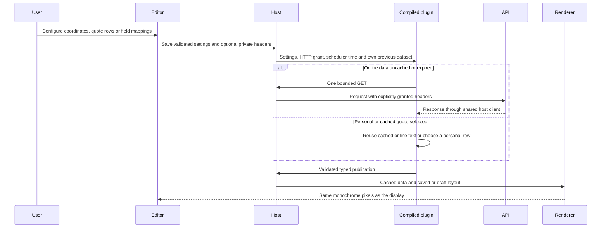
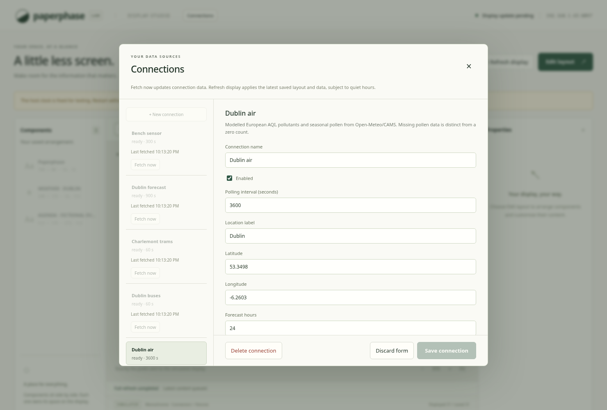
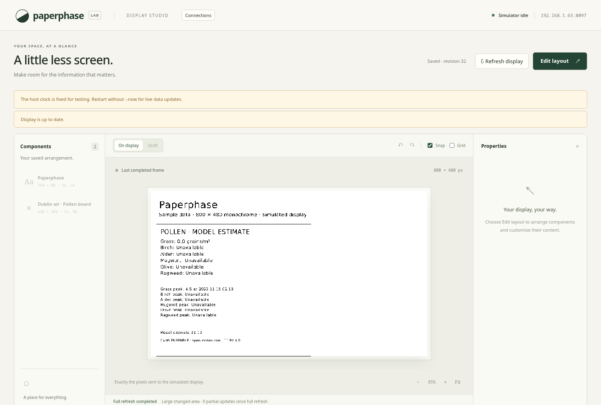
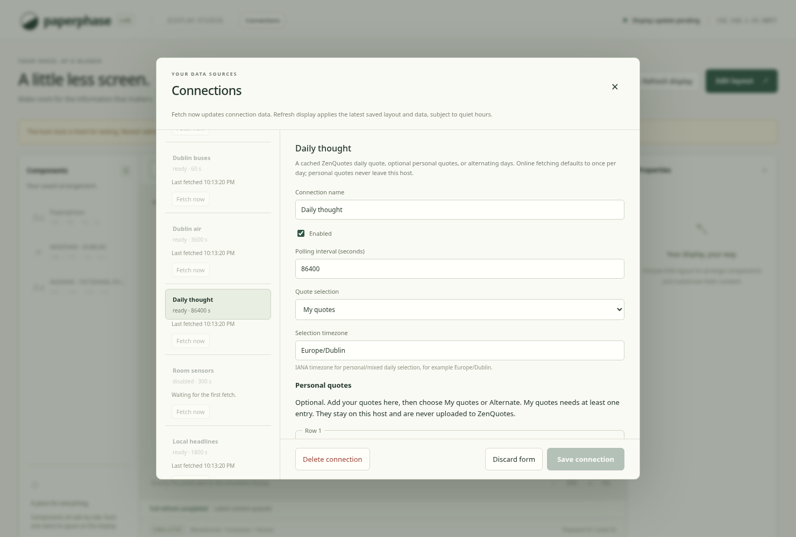
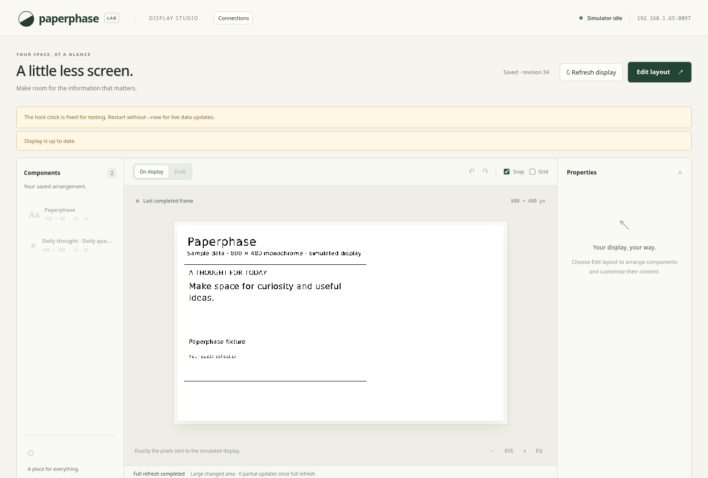
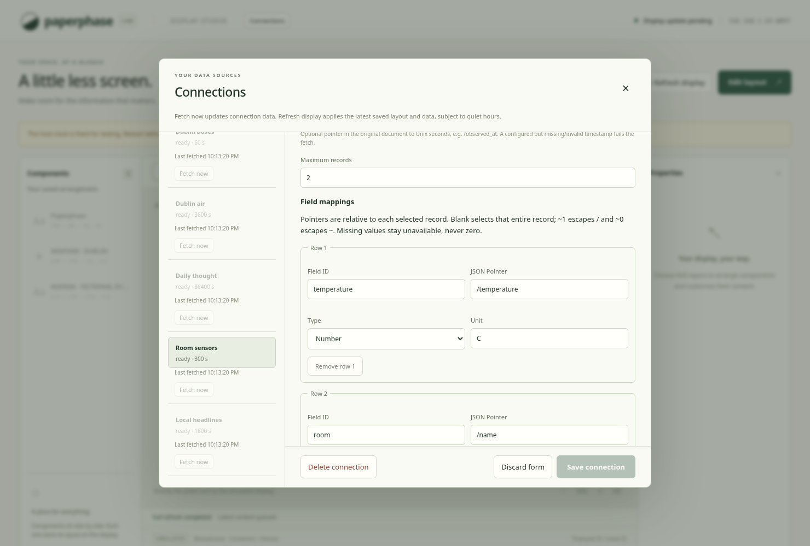
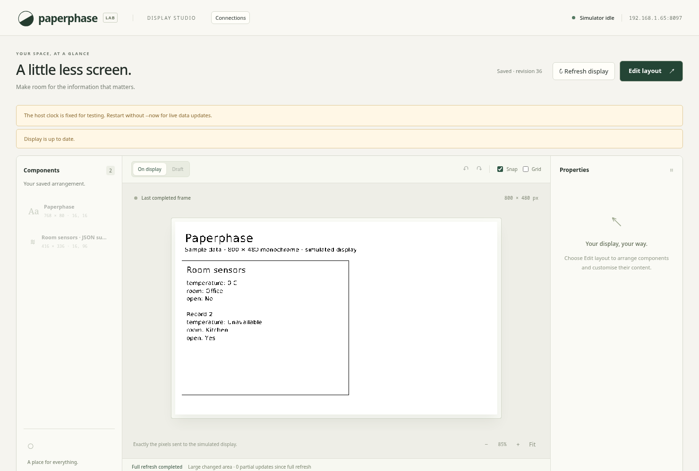

# Air quality, daily quotes and generic JSON

Three compiled Rust/Wasm plugins use the existing settings, HTTP pool, polling,
cache, stale indicators and compositor. No plugin creates a web client. The new
row-based settings control is shared by personal quotes and JSON field mappings.

## Air quality and pollen

`plugins/air-quality` calls Open-Meteo once for current conditions and a bounded
hourly window. Settings are a location label, coordinates, 6–48 forecast hours
and a pollen focus. The current, hourly and pollen datasets share the provider's
current timestamp, so forecasts cannot silently become fresh after an old fetch.

| Dataset | Fields |
| --- | --- |
| `current` | European AQI/category, PM2.5/PM10, NO₂/O₃, current pollen text, forecast summaries, model time and attribution |
| `hourly` | Timestamp/local label, AQI/category, pollutant values and six pollen types |
| `pollen` | Type/name, current count, peak count/time, peak label and coverage |

The decoder checks units, nonnegative finite concentrations, parallel array
lengths and ascending timestamps. Missing fields/nulls stay unavailable; zero
pollen remains zero. Peaks use available values and explicitly identify partial
coverage. Local labels use the returned IANA timezone, including date changes.
A six-point text outlook spans the selected hourly window; historical storage
and chart rendering remain separate work.

European AQI categories follow Open-Meteo's published bands: up to 20 Good,
40 Fair, 60 Moderate, 80 Poor, 100 Very poor, then Extremely poor. These are
model estimates rather than a sensor reading at the house. Pollen availability
is regional and seasonal. Templates retain CAMS ENSEMBLE/Open-Meteo attribution.
The default interval is one hour, minimum 15 minutes, with two-hour staleness.
See [Open-Meteo's documentation](https://open-meteo.com/en/docs/air-quality-api)
and [free-service terms](https://open-meteo.com/en/terms).

## Daily quote

`plugins/daily-quote` supports an online daily quote, personal-only selection,
or alternating online/personal days. ZenQuotes supplies plain quote/author
fields; its HTML field is ignored, entities are decoded and text remains plain.
Provider errors, malformed responses and oversize content fail the publication,
retaining last good content through the normal host path.

The `quote` dataset has `quote`, `author`, `source`, `selection-date` and
`attribution`, plus nullable numeric `online-fetched-at`. Online fetches default
to once every 24 hours. The guest also reuses its own previous online publication
for 24 hours when polled more often, preserving the original observation time. Manual fetches and
settings edits still obey the 60-second shared-origin floor. The provider owns
its daily rollover; Paperphase does not promise a new online quote at local
midnight. Personal/mixed selection uses the configured timezone and is stable
within a local date. Its visible change happens at the next configured poll.
Use a shorter poll interval for personal mode if a closer midnight change matters.

Personal rows contain bounded quote/author strings. The date ordinal modulo list
length selects the personal quote; alternating mode uses the date parity and
advances its personal index every two days. An empty mixed list uses online data;
personal-only mode requires at least one entry. Personal selections make zero
HTTP calls and never upload their content. The list order controls rotation.
No third-party quote collection is bundled; fixtures contain original examples.

The displayed attribution links back to `https://zenquotes.io/` for online
content. Provider shape, caching advice and limits were checked against the
[official documentation](https://docs.zenquotes.io/zenquotes-documentation/).

## Generic JSON

`plugins/generic-json` fetches the configured URL once, with optional private
Authorization or X-API-Key headers supplied by the host. The existing exact-origin
check and disabled redirects apply. A configured observation pointer reads Unix
seconds from the original document; otherwise freshness uses successful fetch
time. A missing/invalid configured timestamp fails instead of pretending freshness.

A records pointer chooses an object/scalar or an array. Up to 20 records and 16
field mappings are retained. Each mapping supplies an ID, JSON Pointer, explicit
text/number/boolean type and optional unit. Pointers are relative to each record;
blank selects the whole record, `~1` escapes slash and `~0` escapes tilde. No
expressions, coercion, wildcard expansion or scripts are evaluated.

Missing leaves and explicit null produce null. Wrong types, nested values mapped
to scalar fields, invalid roots and excessive output fail atomically. Zero and
false remain their original values. Valid empty arrays publish an empty `records`
dataset and a readable **No records** summary. `overview` supplies a title and
bounded summary for a template independent of the chosen field names; individual
fields can also be bound through the normal internal editor.

The normal 64 KiB response, 10 million fuel, 32 MiB guest memory and 64 KiB
publication limits remain in force. Summary text is additionally bounded to
4,096 bytes. Defaults are five-minute polling and 15-minute staleness; registration
can adjust the latter for a particular deployment. JSON Pointer semantics follow
[RFC 6901](https://www.rfc-editor.org/rfc/rfc6901).

## Shared settings and time capabilities

`SettingInput::Table` describes up to 32 rows and eight columns. Each column has
an ID, label, required flag, byte limit, optional choices and multiline flag.
Rows are string-keyed objects; the host rejects unknown columns, wrong types,
invalid choices and bounds violations before persistence. Required tables cannot
be empty. The editor renders normal text/choice controls with add/remove actions;
default arrays are cloned so editing one connection cannot alter another's defaults.

The `previous_dataset` import exposes only this same connection's previous
primary dataset, not other connections or secrets. It permits one read of at
most 64 KiB per invocation; the host validates and bounds it before granting it.
The quote plugin uses the persisted fetch timestamp to cache online text across
settings changes/restarts. Cached plain text is not HTML-decoded a second time.

The `unix_time` import returns one fixed timestamp per invocation. Server runs
receive scheduler time, including the deterministic clock used by tests; CLI
runs default to the host time captured at invocation. The guest gains no OS/WASI
clock access. Legacy guests need not import this capability.

Header registrations can bind optional secret fields. Missing/empty optional
secrets produce no header; required secrets are still enforced by connector
settings validation. Saved values remain absent from public settings reads.
Private connection storage retains the existing restricted-file policy.

Native tests cover malformed/missing data and typed mappings; compiled tests
exercise host networking, private headers, fixed time and personal mode's zero
HTTP requests. Browser flows exercise generated row controls, saved settings,
component placement and preview/display equality. The complete desktop pass
includes 153 Rust tests and 18 browser flows; live probes verified both online
providers. Pi resource measurements and physical display checks remain pending.
