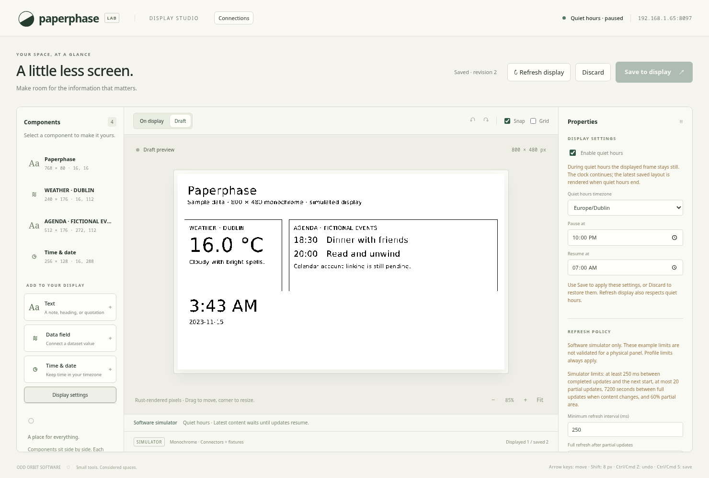
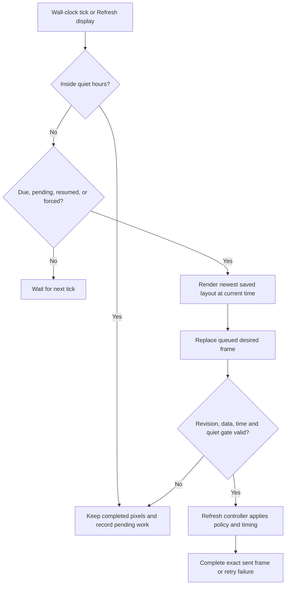

# Clock and simulated refresh scheduling

The built-in time/date template uses the host clock. It needs no plugin, HTTP
request, credentials, or browser timer for its displayed values. Quiet hours gate
the start of display updates while saving and draft previews remain available.
The [refresh controller](refresh-controller.md) now adds synthetic partial/full
policy, batching, serialized active operations, and retry recovery. Validated
physical profiles and retained-frame recovery remain separate work.

The screenshot uses the test clock pinned at 2023-11-14 22:13 UTC. The draft
contains separate time/date blocks using Asia/Kolkata. The displayed
frame remains unchanged during quiet hours. All data shown is a fixture.

## Clock blocks

`TextSource::Clock { clock: ClockSpec }` joins the existing literal and dataset
sources. It passes formatted text into the same renderer, clipping, typography,
and block flow. It does not reserve a stale-data band because it has no external
source. Mixed components still reserve that band when they include data bindings.

| Field | Meaning |
| --- | --- |
| `timezone` | Valid IANA timezone, such as `Europe/Dublin` or `UTC` |
| `content` | `time`, `date`, or `date_time` |
| `hour_cycle` | `twenty_four` or `twelve`, without seconds |
| `date_format` | `long`, `short`, `iso`, or `weekday` |

For example, `date_time`, `twelve`, and `iso` can produce `3:43 AM` followed by
`2023-11-15` on the next line. English date names and four date presets are
implemented; arbitrary format strings and localisation are not. Invalid zones
and timestamps outside Chrono's calendar range return validation errors.

The Time & date template creates two clock blocks so time and date can have
different font sizes. Settings are per block, including timezone. Any text/data
block can also be changed to a clock source. The browser obtains the host's zone
list from `/api/timezones`; it does not decide timezone offsets itself.

Chrono and Chrono-TZ provide calendar arithmetic and a timezone database compiled
into the binary. No system timezone file or external timezone service is needed.
Updating those rules requires an application/dependency update.

## Deadlines

For a time-bearing block, `next_change_after` returns its next local minute
boundary. For a date-only block, it resolves the next local date boundary rather
than adding 86,400 seconds. A normal midnight resolves immediately. A skipped
midnight is searched minute by minute for the first valid civil time; a skipped
whole date advances to the following date. Ambiguous candidates choose the
earliest instant after the current time. The exceptional search is bounded to
three dates. Tests include Dublin's 23/25-hour days, a São Paulo midnight gap,
and Apia's skipped date.

The service takes the earliest clock deadline and freshness deadline for bound
snapshots. Freshness deadlines use the older observation/fetch time plus the
stale interval. A future-dated snapshot is reconsidered when time catches up.
No deadline is needed for literal-only content or permanently failed fixtures.
The [compiled connection layer](compiled-connectors.md) now supplies new snapshots
through an independent fetch scheduler.

One Tokio task checks wall time every second, using skipped missed ticks. It
renders only when due, resuming from quiet hours, handling a backward clock
adjustment, recovering a pending update, or servicing Refresh display. Large
forward jumps render the latest state once. Unchanged PNG pixels acknowledge the
saved revision without a simulated refresh. The render path is bounded and uses
blocking workers, as described in [desktop-editor.md](desktop-editor.md).

## Refresh state

| State | Purpose |
| --- | --- |
| Saved revision | Changes only when a layout/settings transaction is persisted |
| Displayed revision | Last saved revision acknowledged by the completed frame |
| Frame serial | Advances after each successful operation, including clock-only changes and baseline recovery |
| Desired frame | Replaceable queued content, separate from an active operation |
| `next_due` | Earliest known clock/freshness change |
| `pending` | A newer display evaluation/completion is still needed |
| `quiet`, `refreshing`, `pending`, `last_error` | Determine `paused`, `refreshing`, `pending`, `idle`, or `error` status |

The API's `frame_id` combines a process/start identity and frame serial. Browsers
use it to retrieve new pixels even when no layout edit occurred, including after
a restart. Draft clock previews are updated independently at minute boundaries.
Layout/settings revision conflicts still preserve drafts.

The [refresh controller](refresh-controller.md) now owns batching, unchanged-frame
checks, partial/full decisions, minimum intervals, and simulated execution.
Revision, data, clock, and quiet-hours checks happen before an operation starts.
An active operation finishes even if newer content arrives or quiet hours begin;
its exact frame is recorded, and newer content remains pending. A later tick
regenerates obsolete queued work. This replaces the earlier render-token delay.

## Quiet hours and persistence

`Saved.refresh_settings.quiet_hours` is optional. Existing version-1 workspaces
without it load with quiet hours disabled. Settings share the layout's atomic
save and revision check. The editor includes settings in Undo/Redo and Discard;
changing a checkbox does not apply it until Save.

Quiet hours contain a timezone and distinct `HH:MM` start/end values. The interval
includes its start and excludes its end; crossing midnight is supported. The
gate checks the local wall time, so skipped/repeated daylight-saving times follow
that wall-clock rule. Equal endpoints are rejected rather than meaning an
undocumented all-day interval.

While paused, saves remain durable and explicit refreshes remain pending. On
resume the service renders the newest saved layout with the current time and
freshness, rather than replaying frames from the pause. Draft previews continue
to work. Registered connector fetching runs independently of this display gate.

The simulator initialises a frame from the saved layout on startup, even during
quiet hours, then applies the gate. Its previous completed pixels are not stored
across service restarts. Physical retained-frame reconciliation is not implemented.

## Validation

The clock is supplied to the service as an injected function. Production uses the
system clock; `--now` fixes it for demos. Tests inject an atomic clock and advance
it directly, without a production endpoint that changes the system clock.

Tests cover time/date formats, midnight/noon, timezone date changes, daylight
saving, civil-time gaps, invalid input, literal/clock pixel equality, minute and
stale-data deadlines, missed ticks, backward adjustments, quiet pause/resume,
multiple saves during a pause, quiet-hour entry before and during an operation,
superseded queued frames, and skipped unchanged frames. API tests cover old-file
compatibility, settings validation/persistence, and refresh gating. Chromium
checks clock properties, settings history, paused displayed pixels, reload, and
resuming through a saved settings change. Pi resource and physical-panel checks
remain pending.
