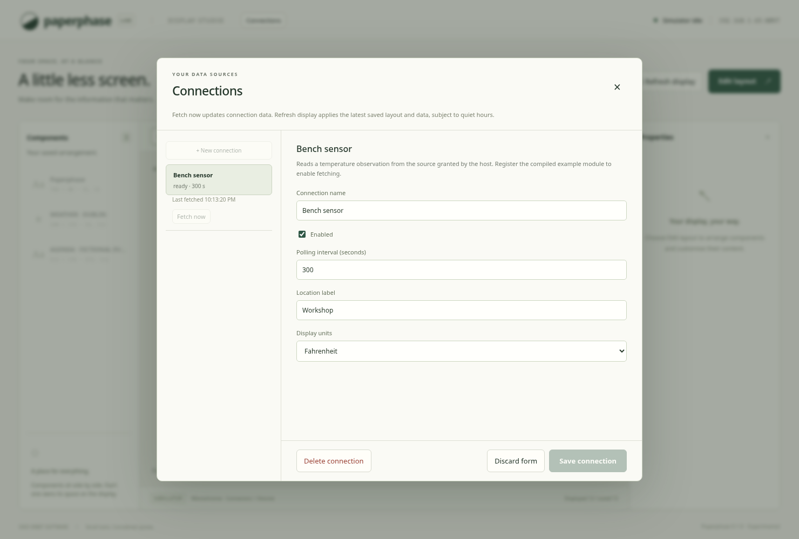
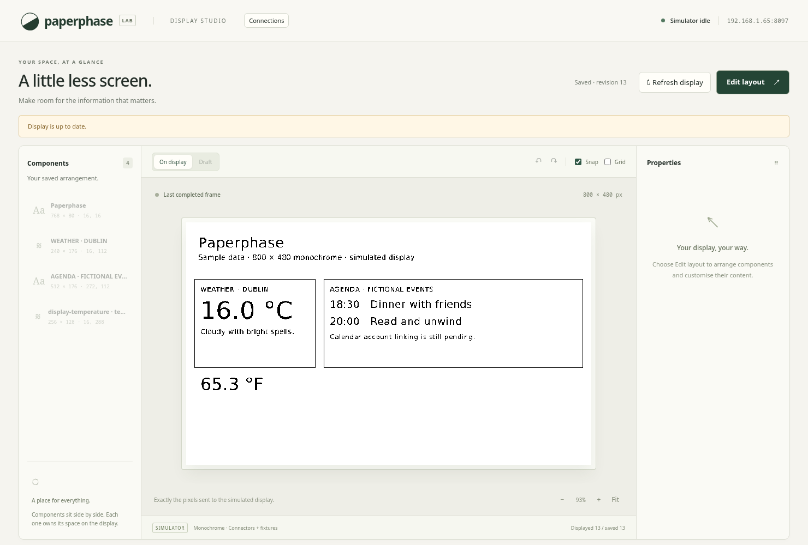
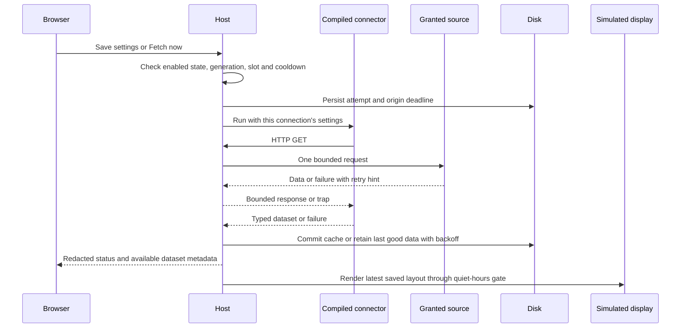

# Compiled connections and polling

Saved connections can now execute registered portable Wasm modules through the
shared Rust host. Polling, Fetch now, cached datasets, and display refresh are
separate operations. The display remains simulated. Registration uses a local
file; package installation and the final public plugin contract remain pending.

This actual Chromium screenshot uses the compiled Rust example and a local
18.5 °C API fixture. The example publishes a Fahrenheit display value from its
connection settings. It is not a live weather integration or a panel photograph.

The lower component displays the fetched `display-temperature` value through
the same renderer as the rest of the layout.

## Registration and execution

`--connector-bindings` reads a version-1 registration file with up to 32 bindings:

| Field | Meaning |
| --- | --- |
| `connector_id` | An existing settings-definition ID, unique in this file |
| `wasm` | Portable binary module, relative to the registration file or absolute |
| `source_url` | Explicit HTTP(S) source and exact scheme/host/effective-port grant |
| `stale_after_secs` | Fetch-age threshold, 1–604,800 seconds |

The host creates one `PluginRuntime` before entering Tokio, then validates and
compiles each module once. All connections share its HTTP client and compiler;
each invocation receives a fresh Wasmtime store and quotas. No publisher-supplied
native cache is deserialised. A single execution semaphore limits active guests
to one. Blocking workers perform guest/HTTP work without blocking async workers.

Service executions allow one HTTP attempt per invocation, preserving the
shared-origin polling floor even if a guest tries a second request. The standalone
foundation harness retains its four-request test limit. Other existing budgets
remain: 2 MiB module, 32 MiB guest memory, 512 KiB guest stack, ten million fuel,
three-second request deadline, and 64 KiB response/publication limits. These are
experimental limits, not Pi measurements.

The `paperphase_v0` ABI adds `settings_json(pointer, capacity)`. It copies at most
16 KiB of the connection's normalised JSON settings, including that connection's
secrets. The SDK exposes `settings()`. Existing guests using the original imports
remain supported; the updated temperature example needs the new host call.

An origin grant is not a URL-path or resolved-IP restriction. Registered code is
trusted with its own configured credentials and permitted origin: a sandbox does
not prevent a malicious connector from publishing those values as data. Other
connections' settings, files, arbitrary sockets, and hardware are not exposed by
the guest API. The host returns only generic fetch errors, not guest/provider
payloads, and `RunConfig` debug output omits settings and the full source URL.

## Durable state and scheduling

The existing private connection file adds optional `data` and `origin_deadlines`
maps. Older settings-only files load with empty maps.

| State | Role |
| --- | --- |
| Configuration revision | Advances only for connection Save/Delete, preserving editor conflict checks |
| Per-connection generation | Changes on configuration edits/recreation, invalidating old invocations |
| `ConnectionData` | Latest snapshot, attempt/due/retry times, failure count, generic error |
| In-flight flag | Runtime-only state, cleared on restart |
| Origin deadline | Persisted cooldown shared by all bindings using the origin |
| Data epoch | Runtime counter invalidating old previews/completions without changing layout revisions |

Each second the fetch scheduler chooses the earliest eligible enabled connection.
Manual fetching can run before its normal polling time, but must satisfy the
same connection/origin cooldown and execution slot. Disabled/unregistered sources
are rejected. Busy or ineligible requests do not accumulate an unbounded queue.

Before contacting a source, the host persists the attempt, next automatic time,
and cooldown. The origin floor is the largest definition minimum among bindings
for that origin. Consequently, adding another connection or deleting/recreating
an ID cannot reset that origin's budget. Operators still need to verify a real
provider's allowances before configuring its definition.

On failure, retry delay starts at the configured polling interval and doubles,
capped at the larger of one hour or the configured interval. HTTP 429/503 trigger
shared-origin backoff. Retry-After accepts delay-seconds or an HTTP date, following
[HTTP semantics](https://www.rfc-editor.org/rfc/rfc9110.html#name-retry-after);
longer provider delays are preserved beyond the normal backoff cap. The runtime's
`run_observed` returns these hints even when the invocation traps. Hints are
isolated per invocation. Editing settings does not clear a cooldown.

## Publication, races, and recovery

Success replaces the connection's latest snapshot and clears its error/failures.
Empty rows are a successful result, replacing an older nonempty result. Failure
retains the previous snapshot and marks it stale. Observation time is not yet
part of this guest result: the service records successful fetch time. Real
integrations still need to account for provider observation timestamps.

Before accepting a completion, compare its captured generation with the current
record. Edited, disabled, removed, or recreated connections discard old data.
Provider retry hints still update the shared origin budget even when the old
connection's data is discarded.

Config edits and fetch completions share the connection mutex, so a fetch cannot
overwrite newer settings. Successful cache publication advances the data epoch
and marks display evaluation pending. Rendering captures a combined fixture/cache
snapshot and epoch. Queueing and simulated completion reject an outdated epoch,
preventing an old frame from overwriting newer data. Layout revision and data
epoch therefore have different purposes. The browser refreshes its dataset catalog
when data changes, including while the display is paused, and preserves form and
layout drafts during those updates.

Caches are limited to 512 KiB in aggregate; the entire pretty-printed connection
file must remain below 1 MiB. Results that do not fit retain previous cached data
and report a budget error. There is one latest dataset per connection, not history
or multiple publication channels.

The shared atomic writer checks its final encoded size against the reload limit
before touching the destination. This also protects layouts whose normalised
representation is larger than their incoming request.

If an attempt cannot be persisted, no HTTP request starts. If completion cannot
be persisted, the old dataset remains, current retry metadata is held in memory,
and further fetching waits until that metadata can be written. Background retries
recover writable storage. A power loss before writing a newly observed hint can
lose that hint; the earlier persisted attempt deadline remains. Provider-specific
interrupted-request recovery is still integration work.

The connection file remains owner-only plaintext, now including cached data and
rate state. Back up the whole file. Restart reuses its successful data and durable
deadlines. The simulator renders this cache at startup; it does not restore a
physical panel's retained framebuffer.

## UI and validation

Connections shows waiting/fetching/ready/empty/stale/error/disabled states and
Fetch now eligibility. Fetch uses saved settings, including when a form has local
edits. Shared cooldowns can disable another connection's button. Connection labels
appear in dataset choices, while bindings retain stable IDs. Refresh display
renders saved content without fetching and still honours quiet hours.

The temperature example reads location/units settings and publishes raw Celsius
`temperature`, formatted `display-temperature`, and `location`. A null source
temperature produces empty rows; malformed/missing values fail. The Rust
`demo-source` command serves deterministic input for local review.

Tests cover settings buffers, per-invocation retry hints, success/failure/empty
data, shared cooldowns, edited/recreated records, stale-frame races, cache bounds,
storage failures, quiet hours, and account-scoped data. CLI integration tests run
the compiled Rust guest through a real local HTTP source and restarted service.
Chromium fetches through that guest, binds its field, saves, and compares preview
and completed PNGs. Pi budgets, real provider rules/OAuth, installation, histories,
multiple datasets per invocation, and physical refresh policy remain pending.

See [running a compiled connector](../usage/compiled-connectors.md).
