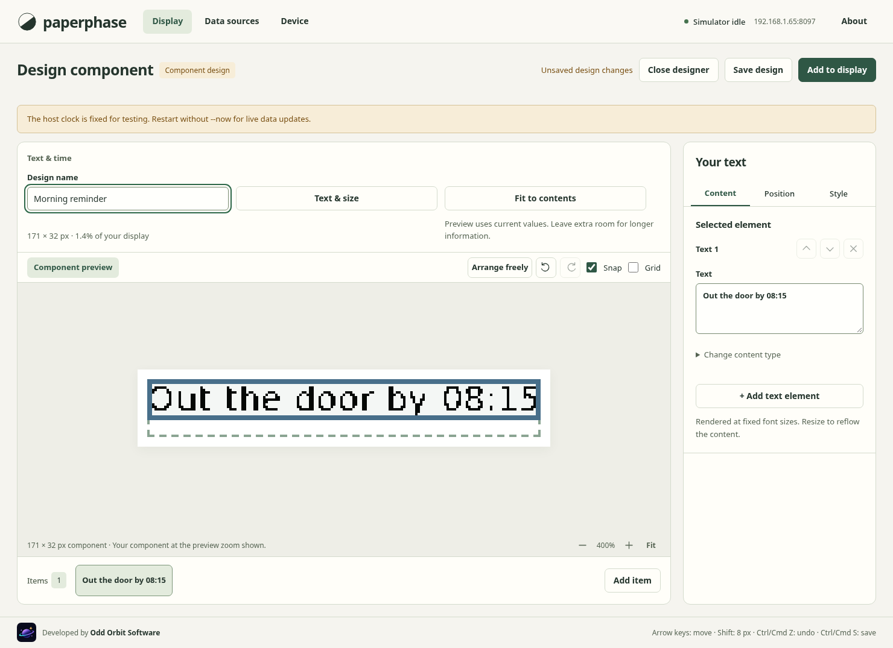
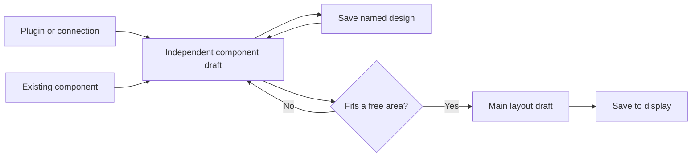

# Reusable component designs

The component designer extends the approved owner workspace. It opens before
placement, so a full display or an unsuitable supplied template does not block
editing. Text starts at 14 px with 4 px padding and a 2 px item gap. Text & size
provides readable presets and a width control; Content, Position and Style keep
precise item, geometry and appearance controls available.

Actual local screens: [weather design](images/component-designer-weather.png),
[saved library](images/component-designer-library.png),
[blank design](images/component-designer-blank.png), and
[laptop layout](images/component-designer-laptop.png). All data is synthetic.

## Independent draft and library

`DesignSession` retains the previous layout/settings draft, selection, undo/redo,
preview and page. The shared editor operates on a virtual one-component layout.
Closing restores the retained state; adding/applying restores it and records one
ordinary layout change. The completed display updates only after Save to display.
Library save is separate and never writes the layout.

`workspace.designs.json` sits beside `workspace.json`. Its schema contains
`schema_version`, a conflict-detection `revision`, and up to 128 named designs.
Each design holds an ID, plugin ID, name and component. Component coordinates are
relative and data bindings use `design.source`; insertion rebinds them to the
chosen connection of that plugin. Connections, credentials and fetched snapshots
are not copied into the library. Literal text may be personal, so design files
are ignored by Git and should be included in private workspace backups.

GET `/api/designs`, PUT/DELETE `/api/designs/{id}` use the host's same-origin
protection. Writes require the current library revision and validate before
atomic persistence. Failed storage leaves memory/revision unchanged. A conflict
retains the browser draft and offers an explicit library reload. Removed-plugin
designs remain stored, but editing requires the plugin again.

## Content fitting

POST `/api/component-fit` measures the actual host renderer and current data.
Renderer block reports include natural width, minimum glyph width and unclipped
height. Flow fitting compares a bounded set of widths, including natural width,
then balances occupied area with a penalty for excessive wrapping, preferring
choices that fit the panel. Fixed-width
fitting wraps at that width. It retains font sizes and every item, including the
18 px data-status reservation. Positioned fitting enlarges genuinely clipped
item boxes and then trims the outer component; it keeps positions and fonts.
Internal boxes may overlap within the content bounds, while whole components
remain separate for display-area updates. Render work shares the existing concurrency limit.

Fitting is a current-values estimate: longer future information may need more
room. Per-item clipping is based on visible ink rather than nominal line spacing.
Warnings identify clipped items without blocking a structurally valid design
from being saved or placed. Invalid boxes still prevent save/placement; failed
placement retains the editable design.
Free placement searches display and neighbour edges without adding mandatory
margins. Empty drafts can be edited but cannot be saved or placed.

Stacked items use renderer-reported hit boxes for selection. Arrange freely
explicitly converts them to positioned boxes. Mouse selection now supports
Delete and Undo for both components and internal items, while text controls and
confirmation dialogs retain their native keyboard behaviour.

Icon data bindings offer text fields and prefer a source’s `icon-key`/`icon-id`
field instead of an arbitrary first text value. If no text fields are available,
the field-following choice is disabled with an explanation. Designer item rows
use one-based numbering; persisted bindings remain zero-based.

Follow-up captures: [clipping warning with Save available](images/component-designer-clipping.png)
and [icon following a source field](images/component-designer-linked-icon.png).
