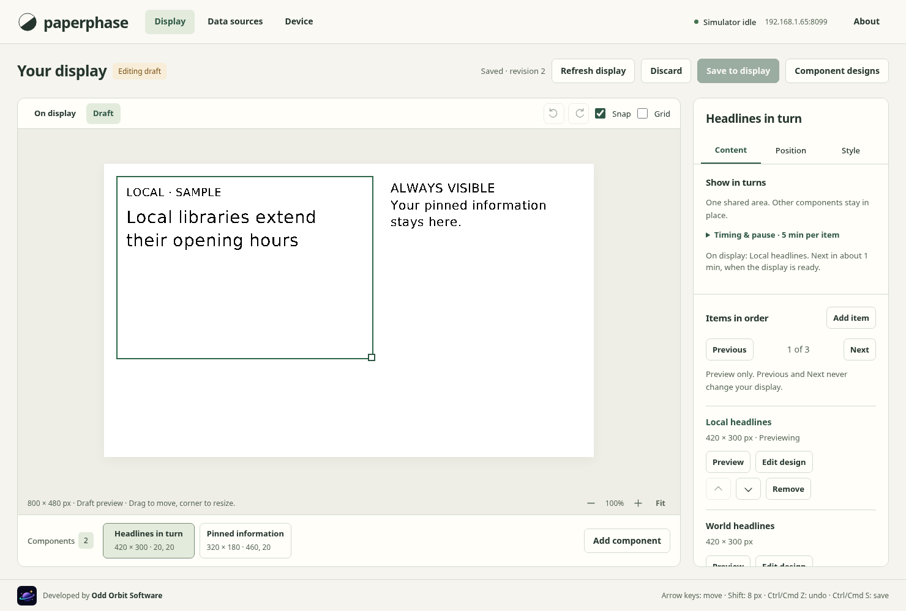
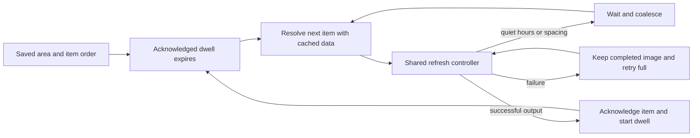

# Components shown in turns

A top-level `Component` optionally owns a `Rotation`: an ordered vector of
1–8 independent component copies, `interval_secs` (5–86400 seconds), `paused`
and an optional `paused_member`. The owner UI starts at five minutes per item.
Each member has local coordinates `(0,0)` and retains its own dimensions,
blocks, bindings, typography and refresh preference. Members cannot themselves
contain rotation. Smaller items occupy the top-left of the reserved area;
unused pixels stay blank. The outer rectangle owns all its space and cannot
overlap another top-level component, including its unused space.

Validation checks every inactive member and counts all stored text against the
existing layout budget. Layouts permit at most 128 presentations in total.
Library designs are copied into the layout; deleting the library record does
not remove a placed item. Whole rotating areas cannot be saved as reusable
individual designs or sent to the component fit operation.

`Layout::resolve_rotations` validates the declaration and replaces each area
with its selected flat component, retaining the area's identity and position.
The normal renderer therefore retains all clock, icon, stale/missing-data,
privacy, overflow and attribution behavior. It never draws inactive members.
The stronger of the area's and member's refresh preferences applies (Full,
then Partial, then Automatic). Only visible members contribute clock/freshness
render deadlines; provider polling remains independent.

The server keeps an in-memory presentation record per area: acknowledged member,
monotonic start instant and pause state. It predicts at most one next item. A
successful driver acknowledgement starts that item's dwell. An identical-pixel
transition can acknowledge logically without operating the panel. Data changes
and maintenance refreshes of the same item do not reset dwell. Pausing retains
a selected item; resuming gives it a full new dwell. Restart begins at the first
or configured paused item without replaying missed turns. A physical startup
makes no shown-item claim until its recovery full refresh succeeds.

All areas use the existing serialized output worker, quiet hours, retry gates,
partial-area limits, shared partial count and timed full cleanup. A failed
switch retains the prior completed image and timer record until recovery.
Missed dwell periods advance once on resume, rather than replaying a backlog.
No skip-empty policy is introduced: unavailable and empty content use the
renderer’s existing visible status/fallback behavior.

`GET /api/state` reports rotation epoch and, for each area, shown and candidate
member IDs, pause state and estimated next dwell deadline. The estimate is not
a promise to bypass panel limits. `POST /api/preview` accepts either the existing
layout body or `{layout, rotation_selection: {area_id: member_id}}`. Preview
selection is validated, never persisted and never sent to the display.

The existing Content inspector contains Show in turns, timing/pause disclosure,
ordered members, Previous/Next, Add item, and edit/reorder/remove actions.
Position edits the shared rectangle; Style edits its refresh preference/name.
The shared picker moves existing components or copies saved designs, or opens
the existing component designer for a new member. Incompatible designs require
an explicit area enlargement with free space or editing to fit. Draft history,
Undo, Discard and Save work across these operations. Keyboard dismissal returns
to the invoking Add item control. Preview navigation stays outside draft history
and cannot make the layout dirty.

Desktop simulator and automated tests are distinct from physical screen checks.
The CLI static simulator renders the first/configured paused item; `serve`
provides timed rotation. See [owner instructions](../usage/component-rotation.md).

## Validation

`sh scripts/check.sh` passed 203 Rust tests and 11 Python adapter tests. The
39 existing browser flows and six rotation flows passed, including creation,
member design/preference editing, source-preserving moves, preview isolation,
pause/order/removal, focus restoration, sizing recovery and independent library
copies. Desktop tests include failed switches, identical-pixel transitions,
quiet-hours resume, renderer boundaries and saved-definition restart. The ARM64
release build also passed.

A fresh Impeccable reviewer checked the rendered desktop/mobile states. Its
four requested changes—first-viewport Add item/list visibility, explicit preview
wording, picker focus/expanded state and documentation—were scored resolved.
The stable timing disclosure and per-member Style preference passed narrow
follow-up review. The established design system was preserved.

On the owner's 800×480 monochrome V2/Rev2.3 hardware, an isolated workspace ran
A → B → A at the configured 300-second dwell. The startup full refresh measured
5.744 s; subsequent partial waveforms measured 0.422 s and 0.417 s. Successful
presentation acknowledgements were about 305 s apart, including render/worker
and transfer overhead. Both partial operations used a 240×72 region. Output
pixel comparison confined every change to the rotating area, and the final A
frame matched the first exactly. The owner confirmed both the initial readable
layout and clean A → B → A with the pinned area unchanged.

The test did not modify the live layout: its hash remained identical. The
regular service was restarted with the tested build and inherited cooldown.
Its recovery full refresh acknowledged saved revision 5, returning to idle
without an error; the normal layout is restored. These results
qualify this cycle on the attached panel; longer-duration ghosting qualification
and real provider/account longevity remain separate foundation work.
