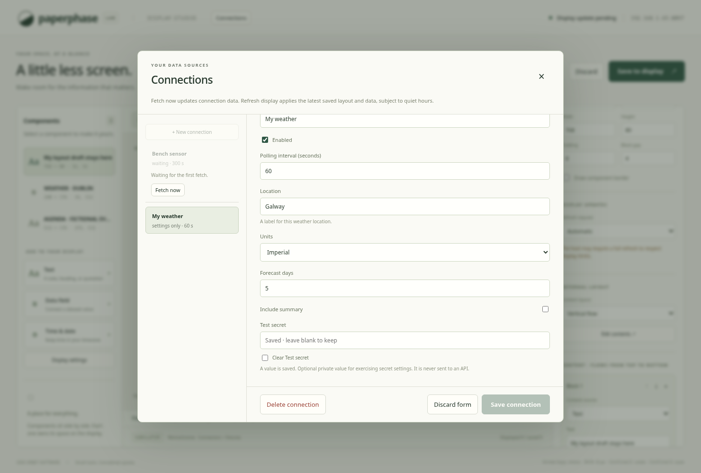
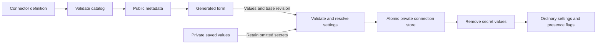

# Connector settings and connection records

Paperphase now generates connection forms from typed connector definitions.
Definitions and saved connection records are independent of component layout.
This is an experimental settings contract, not an executable plugin package or
a stable guest ABI. The bundled demo configures records only: it does not fetch
weather, create datasets, or change the sample display.

This screenshot shows a saved demo record. Its private field is blank and shows
only that a value exists. Save/Discard/Delete stay visible while fields scroll.

## Data structures

`ConnectorCatalog` has schema version 1 and up to 32 `ConnectorDefinition` records.
Each definition has a stable ID, name, description, minimum/default polling
intervals, and up to 32 `SettingDefinition` entries. The example lives in
[`examples/simulator/connectors.json`](../../examples/simulator/connectors.json).

Each setting has an ID, label, optional help, required flag, and a tagged `input`:

| Input type | Definition | Browser control |
| --- | --- | --- |
| `text` | UTF-8 byte limit and optional default | Text input |
| `secret` | UTF-8 byte limit, no public default | Empty password input and explicit Clear checkbox |
| `integer` | Inclusive bounds and optional default | Number input with integer step |
| `number` | Finite inclusive bounds and optional default | Decimal number input |
| `url` | HTTP(S), no credentials/fragments, at most 2048 bytes | URL input |
| `boolean` | Optional default | Checkbox |
| `choice` | Unique value/label options and optional default | Select |

IDs use the existing bounded ASCII identifier rules. Catalog validation checks
duplicates, label/help lengths, defaults, choices, and ordered polling bounds.
Integer bounds must fit JavaScript's exact integer range. Text/secret fields are
limited to 4,096 bytes; choices to 128 entries; the encoded catalog to 256 KiB.
No publisher-provided HTML or script is evaluated. Labels/help are rendered as
text. Unknown fields and unsupported schema versions are rejected.

`ConnectionConfig` contains its stable ID, connector ID, user label, enabled flag,
polling interval, and a map of typed JSON settings. A separate `ConnectionStore`
contains schema version 1, its own revision, and up to 32 connection records.
Layout revisions are unaffected by connection changes. Polling configuration is
validated against the definition's minimum and a one-day maximum; execution and
rate-limit scheduling are not implemented by this slice.

## Validation and secret handling

The host resolves every save against the selected definition:

1. Reject unknown setting IDs. Apply declared defaults to omitted ordinary
   settings. For an existing connection, omitted secrets retain their previous
   value; a connector type change is rejected to prevent cross-connector reuse.
2. Treat explicit null as clearing an optional value. Secret values are removed;
   ordinary nulls remain explicit so they do not silently regain a default.
   Required null/missing values and empty required text are rejected. Boolean
   `false` is a valid value even for a required boolean field.
3. Validate exact value types, UTF-8 byte lengths, integer/choice ranges, and the
   16 KiB encoded settings-map limit. Errors identify a field and constraint,
   without quoting submitted values.
4. Validate connection identity, label, polling interval, and record count. Only
   then persist the updated store and advance its revision.

The public connection response is built explicitly. It includes ordinary
settings and `secret_present` IDs, never secret values or mask strings. Saving an
unchanged blank password input omits it, preserving the server's value. Typing
replaces it; Clear sends null. Secret defaults cannot be declared in a public
catalog. The browser removes its password inputs after successful save, discard,
or close, including before a follow-up list request can fail.

## Persistence and concurrency

The service derives a sibling file from `--state-file`: the default
`.paperphase/workspace.json` uses `.paperphase/workspace.connections.json`.
The file is created on the first connection save. It uses the same atomic
temporary-file, sync, rename, and directory-sync procedure as the workspace.
Temporary files have owner-only permissions on Unix. Secrets are plaintext in
this private file; encryption/key management is not implemented. Backups must
preserve its privacy. This remains a login-free LAN service.

A connection mutex serialises saves/deletes independently of layout operations.
The entire commit runs in an owned task, so a disconnected HTTP client cannot
cancel the operation between file commit and memory commit. A failed write keeps
the previous in-memory revision. Compare-and-swap rejects stale base revisions
with HTTP 409, retaining the browser form until Discard reloads current records.
A connection conflict does not mark a separate layout draft as conflicted.

Startup loads and validates all records against the configured catalog. It never
silently deletes unsupported or invalid settings. Explicit descriptor/fixture
inputs cannot be overwritten by workspace, lock, or connection output files.
The workspace's process lock also protects its derived connection store.

## Browser and HTTP behaviour

Connections opens a modal over the canvas, preserving any unsaved layout draft.
Users create/select a connection, edit generated fields, and Save, Discard, or
Delete it. Changing the connector for a new record resets that new form's values.
An existing record's connector identity is fixed. Closing a dirty form asks for
Save or Discard inside the dialog. Native field validation helps immediately;
the server remains authoritative. Ctrl/Cmd+S submits a connection form while the
dialog is open, and canvas keyboard shortcuts are suspended.

| Endpoint | Behaviour |
| --- | --- |
| `GET /api/connectors` | Validated public definitions |
| `GET /api/connections` | Store revision, redacted records, `settings_only` execution marker |
| `PUT /api/connections/{id}` | Create/update using `base_revision` and typed configuration |
| `DELETE /api/connections/{id}` | Delete using `base_revision` |

Existing host/origin checks, JSON limits, cache prevention, and content security
policy apply to these routes too. The [compiled connection layer](compiled-connectors.md)
now adds a separate Fetch now route; settings saves themselves do not run a guest.
No endpoint installs packages. A custom catalog can be supplied with `--connector-definitions` at
startup; it replaces the bundled catalog and must still describe saved records.

## Validation and remaining work

Core tests cover definition bounds/defaults, exact types, unknown fields, required
values, false/null handling, secret retention/replacement/clearing, UTF-8 limits,
and combined size limits. API tests exercise redaction, private file permissions,
restart persistence, custom descriptors, competing saves, failed writes, deletion,
and independence from layout revisions/pixels. Chromium covers generated field
types, secret placeholders, discard, clear, conflicts, and retained layout drafts.

The [compiled connection layer](compiled-connectors.md) now connects registered
modules to these records, shared fetching, cooldowns, latest snapshots, and Fetch
now. Package installation, real provider validation/OAuth, historical storage,
and the final public plugin/SDK contract remain pending. Real credentials, Pi
performance, and physical display validation have not been exercised by the demo.

See [connection operations](../usage/connections.md).

The [weather/RSS layer](weather-and-rss.md) adds decimal/URL settings and
validated component templates exposed from configured connections in the editor.

Text settings can opt into a multiline editor using `multiline: true`; the value
remains one bounded UTF-8 string under the same server validation. Dublin Bus
uses this for comma/newline stop lists. Authentication headers are granted by
trusted registration to required secret setting IDs, not editable arbitrary
header names. See [Dublin Bus](dublin-bus.md).
