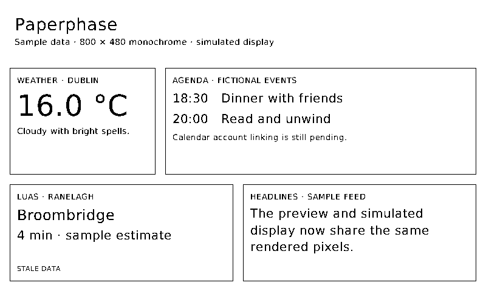
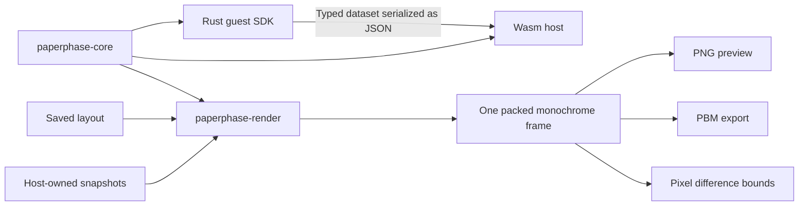

# Shared data model and monochrome renderer

Status: implemented simulator foundation. The desktop editor, plugin package
format, display drivers, and public SDK stability are still pending.

This is a generated 800 × 480 monochrome frame using fictional/sample content,
not a browser mockup or a photograph of the panel. The stale Luas estimate is
intentional. These dimensions describe a simulator profile; the owner's physical
panel remains unverified.

## Package boundaries

`paperphase-core` contains data, snapshot, binding, layout, and validation types.
It depends on Serde and Serde JSON, without Wasmtime, HTTP, font, or hardware
dependencies. `paperphase-runtime` re-exports the existing dataset names to keep
the harness callers compatible. Its wire schema is unchanged.

The guest SDK now re-exports `Dataset`, `Field`, and `FieldKind`, and provides
`publish_dataset`. This validates the dataset before serializing it through the
existing experimental `publish` import. The host validates again. No Rust object
crosses the Wasm ABI, and the renderer is not linked into the guest.

`paperphase-render` owns font rasterization, clipping, packed pixels, image
encoding, and frame differences. The CLI's `simulate` command joins these pieces
without starting an HTTP server or contacting providers.

## Records and identity

| Record | Important fields |
| --- | --- |
| `Dataset` | Schema version, dataset ID, typed fields, rows |
| `Snapshot` | Connection ID, dataset, last successful fetch time, optional observation time, stale interval, last error |
| `SnapshotSet` | Schema version and snapshots keyed by connection/dataset identity |
| `Layout` | Schema version, simulator display specification, components |
| `Component` | ID, rectangle, padding, gap, border, vertically arranged text blocks |
| `TextBlock` | ID, literal/field source, font size, alignment, overflow mode |
| `Binding` | Connection ID, dataset ID, field ID, row position, optional decimal precision, prefix/suffix |
| `ComponentReport` | Component ID, data state, rendering/binding warnings |

IDs are case-sensitive ASCII identifiers of 1–64 bytes using letters, digits,
underscores, hyphens, and dots. They are separate from visible text: changing a
caption does not change its binding. Snapshot identity is a tuple, not a
concatenated string, so two accounts can expose the same dataset ID safely.
Duplicate connection/dataset keys are rejected.

Binding row positions are currently positional, not stable event IDs. This
supports scalar cards and chosen rows; repeated lists and keyed items remain
future builder work. Units are metadata, and prefixes/suffixes are literal text;
there is no unit conversion or executable formatting language.

The initial JSON schemas use version 1 but remain experimental. Public package
compatibility, migration, credentials, settings, and template-distribution
contracts are not implied by this schema version.

## Geometry validation

Validate before allocating a frame or writing an output image:

1. Check schema version, display dimensions, pixel budget, and component count.
2. Check unique component/block IDs, positive usable rectangles, and style limits.
3. Sum coordinates in 64-bit integers to prevent 32-bit coordinate wraparound.
4. Require each rectangle to fit inside the display and leave room for padding.
   Components with data bindings also reserve an 18-pixel status band.
5. Compare each rectangle with earlier rectangles. Reject positive-area
   intersections; touching edges are valid.
6. Validate source references, formatting limits, and total literal-text bytes.

With at most 64 components, pairwise collision detection needs at most 2,016
comparisons. Pixel rectangles use half-open bounds: a rectangle at x=0 with
width=32 contains pixels 0–31. The same contract can validate future editor saves
independently of browser zoom.

Validation errors carry a field path and message, such as
`layout.components[1].rect: component overlaps another component`. Snapshot
dataset errors retain the snapshot index and dataset field path.

## Binding and freshness

Build a snapshot index once per render. Resolve each field using its connection,
dataset, field, and row references. Validate numeric precision against the
declared field type. Preserve integer text when no decimal conversion is asked
for; explicit precision uses floating-point formatting.

The caller supplies the last good dataset when fetching fails. The renderer
does not fetch or retain history itself. A snapshot is stale when a fetch error
is present, its age reaches the configured interval, or a timestamp lies ahead
of the render clock. If observation time is available, use the older of that
time and the successful fetch time so fetching old upstream content cannot make
it appear fresh.

Keep valid stale values visible and draw `STALE DATA` inside the reserved band.
Missing references, missing rows, null values, or incompatible formatting use a
placeholder and `NO DATA`. A successful empty dataset instead renders `No items`
with the source's freshness state. Error details are not painted on the panel.

Reports list source and rendering problems per component. Status does not imply
a connection to physical hardware; the CLI labels the overall result `simulated`.
Freshness is evaluated when rendering is requested. Automatic scheduling and
quiet-hours enforcement belong to the future service/controller.

## Text layout and rasterization

Use the bundled, unmodified DejaVu Sans 2.37 font for consistent glyphs without
requiring fonts on the Pi. Attribution and the upstream licence are in
[assets/fonts](../../assets/fonts/README.md).

Each component is a vertical stack of text blocks with fixed font sizes, padding,
and gaps. Resizing changes available width; it never scales the font implicitly.

- `wrap`: word wrapping within the width, with vertical overflow clipped.
- `clip`: one line, clipped at the component's content boundary.
- `ellipsis`: shorten by Unicode characters and append an ellipsis that fits.

Support left, centre, and right alignment. Substitute the font's replacement
character for missing glyphs and report a warning. This handles accents and
supported Unicode characters, but is not a full shaping/bidirectional text engine.

Fontdue positions and rasterizes glyphs. Turn coverage of 128 or greater into
black pixels; the final image has no grayscale antialiasing. Clip every painted
pixel to the block's remaining content rectangle. Text cannot reach neighbouring
components or overwrite the host's status band.

Reuse the text layout context and cache rasterized glyphs by glyph/size/font key.
Clear the cache when it reaches 1,024 entries or would exceed 2 MiB of bitmap
storage. These are initial implementation limits, not Pi measurements.

## Frame representation and changes

`Frame` stores row-major, MSB-first packed pixels with a row stride of
`ceil(width / 8)`. A set bit means black ink. An 800 × 480 frame takes 48,000
bytes. The simulator bounds dimensions to 4,096 per side and 4,194,304 total
pixels before allocation.

PBM export writes this buffer directly. PNG grayscale uses the opposite bit
polarity, so the encoder inverts the same pixels. Tests decode PNG output and
compare every pixel with the frame, including widths not divisible by eight.
Panel-specific polarity and alignment conversion remains driver work.

Frame comparison XORs corresponding bytes, skips unchanged bytes, and finds the
union bounds of changed pixels. Ignore row padding beyond the logical width.
Return no region for identical frames and reject comparisons across different
dimensions. Since each desired frame starts white, moved and removed components
invalidate their previous pixels naturally. This is a change detector, not yet
a partial/full refresh scheduler or a display-health policy.

## Verification and remaining scope

Tests cover geometry overflow and collision rules, snapshot identity/freshness,
buffer encoding, clipping, reflow, stale content, missing data, Unicode fallback,
and moved/removed pixels. CLI tests check output files and failure preservation.
A compiled Rust plugin is also fetched through the real host boundary, wrapped
as a snapshot, bound to a component, and rendered by the CLI.

The complete `sh scripts/check.sh` passed on x86-64 Linux with 40 tests:
18 Wasm boundary, 7 model, 10 renderer, and 5 CLI tests. Formatting, host/guest
Clippy, and the compiled guest build passed. The generated frame above was
visually inspected. Pi resource and physical-display validation remain pending.

The next layers are the desktop editor/service, persistence, fuller builder
nodes, a plugin package/settings contract, and automatic refresh scheduling.
The built-in live clock, real provider integrations, physical drivers, and Pi
validation remain pending.
