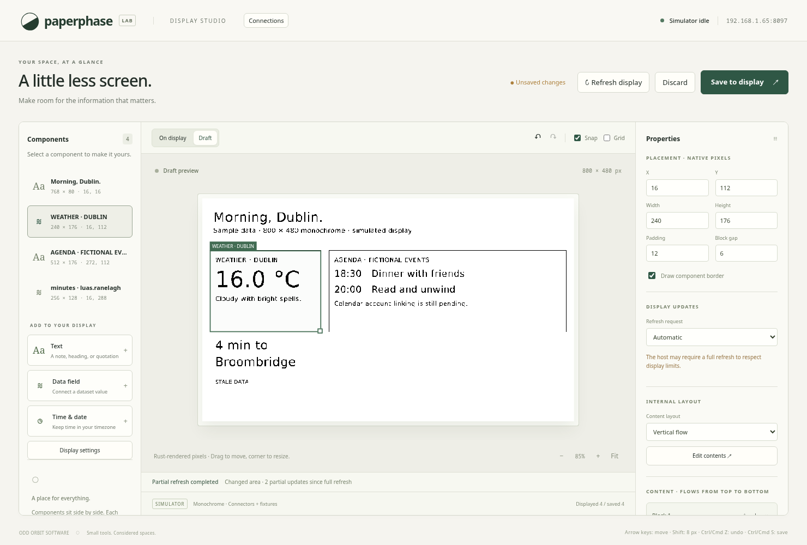
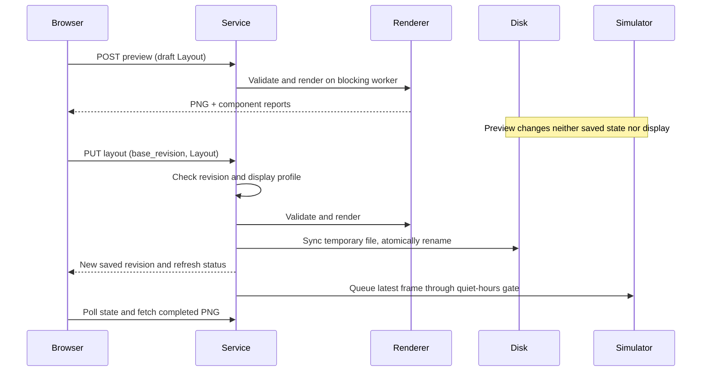

# Desktop editor and simulated service

The first browser editor runs inside the Paperphase Rust executable. It edits
text and typed-data components against a simulated monochrome display. It does
not drive GPIO/SPI yet. Registered compiled connectors are described in the
[connection execution design](compiled-connectors.md).

This is an actual Chromium screenshot of the running service, using fictional
agenda items and deterministic weather/Luas fixtures. The simulated 800 × 480
profile is not a confirmed identification of the owner's physical panel.

## Views and interaction

**On display** opens by default and shows the last completed simulated frame.
**Edit layout** creates a browser-local draft. The left panel selects components
and adds text/data templates; the right panel controls geometry, spacing, borders,
and ordered text blocks. Blocks support literal text or a connection/dataset/
field/row binding, numeric precision, affixes, fixed font size, alignment, and
wrap/clip/ellipsis overflow. All datasets in the current fixture catalog are
available to every component.

[Internal element editing](internal-editor.md) now adds positioned text/data/clock
boxes and a cropped component canvas. Existing components retain vertical flow
until the user chooses Edit contents.

Dragging converts pointer distances from CSS pixels into native display pixels.
Optional snapping rounds coordinates/sizes to an eight-pixel grid. Each proposed
rectangle is checked against panel bounds, minimum size, padding/status space,
and every other component. Invalid positions appear red. A valid proposal becomes
the gesture's `last` rectangle; release at an invalid position restores that
rectangle. Neighbours never move. Pointer cancellation or Escape restores the
gesture's starting layout. Resizing changes geometry without scaling fonts.

Numeric geometry uses the same local checks; Rust performs authoritative model
validation before previews and saves. Keyboard arrows move one pixel, or eight
with Shift. Delete removes the selected component. Undo/redo stores at most 50
whole-layout snapshots, treats a drag as one edit, and groups typing into short
bursts. Text fields keep native text-editing undo. Save and Discard are explicit;
switching views preserves the draft. Closing/reloading a dirty tab triggers the
browser's unsaved-change prompt. Drafts are not otherwise recovered after closing.

New templates scan native coordinates in eight-pixel steps for an unoccupied
256 × 128 rectangle. If none fits, the editor asks the user to make room rather
than rearranging existing content. Components and blocks receive stable random
identifiers from the browser's cryptographic random source, available on LAN HTTP.

## State and rendering

| Structure | Contents and ownership |
| --- | --- |
| `Saved` | Disk schema version, monotonic `revision`, validated `Layout` |
| `Workspace` | Saved state, completed display revision, completed PNG; mutex-protected |
| Browser draft | Independent layout copy, selected ID, undo/redo stacks, draft PNG |
| Snapshot catalog | Connection/dataset IDs, field schemas, row counts, freshness; no account credentials |
| `Preview` | PNG encoded as base64 plus per-component data state and warnings |

The browser never rasterises component text. Draft changes are debounced for
120 ms and sent to the shared Rust `Renderer`. Responses from older requests are
discarded, including during the debounce window. The native PNG is scaled only
for workspace zoom. Displayed pixels and draft pixels use distinct endpoints.

Rendering runs on Tokio blocking workers behind one renderer mutex. A semaphore
allows at most four accepted render jobs, including the running job; excess work
receives HTTP 429. The renderer's bounded glyph cache is reused. The service uses
two async worker threads, and no Node process is needed on the Pi.

## Saving and recovery

Saves use compare-and-swap: the supplied base revision must equal the current
saved revision. A second check serialises competing saves before persistence.
An outdated tab receives HTTP 409 and keeps its draft. Polling also detects newer
saved layouts; Save is disabled until Discard loads the current workspace. This
first editor does not merge drafts or offer an overwrite shortcut.

Persistence writes a same-directory temporary file, syncs it, then atomically
renames it over the workspace. The rename is the commit point. A later directory
sync error is logged without pretending the commit failed. Errors before rename
leave the in-memory revision unchanged. The commit task survives a disconnected
HTTP client so cancellation cannot leave disk and memory at different revisions.
An OS file lock prevents a second service from using the same workspace path.
Startup rejects malformed, oversized, or unsupported saved state and prevents
workspace/lock paths from replacing explicitly supplied fixture inputs.

The [refresh controller](refresh-controller.md) batches pending frames for 180 ms,
then applies policy and simulates a serialized operation. Unchanged pixels need
no refresh. A later save replaces queued content; active operations finish before
newer work starts. Until completion,
the displayed revision and image remain distinct from the saved revision. On
restart, the simulator immediately renders the saved layout from the supplied
snapshots; it does not claim to recover a physical panel's retained pixels.

## HTTP boundary

The service binds loopback by default; LAN binding is explicit. Requests must
use a known local address/hostname and the listening port. Browser Origin and
Fetch Metadata checks reject foreign-site requests, and CORS is not enabled.
JSON bodies are limited to 1 MiB. Responses are uncached; a content security
policy limits scripts/connections to this service and prevents framing.
This is a login-free LAN service. These checks do not authenticate LAN users.

The header shows simulation status and a host address, preferring the browser's
LAN address or a conventional Ethernet/Wi-Fi interface. Its tooltip lists all
discovered addresses. Loss of service marks the header unavailable, preserves
the draft, and disables Save until polling reconnects.

## Scope and validation

The fixtures are fixed at startup. The [clock and refresh layer](clock-and-refresh.md)
now adds time/date blocks, automatic clock/freshness deadlines, quiet hours, and
Refresh display. The [compiled connection layer](compiled-connectors.md) now adds
registered guest execution, polling, latest data, and Fetch now. The clock can be
pinned with `--now`. Package installation, historical storage, refresh budgets, and physical
refresh policy remain subsequent work. There is no hardware status
disguised as an attached display, and the short simulator delay is not a panel
timing claim.

[Connector-defined settings forms](connector-settings.md) now provide separate
connection records and private values. Startup fixtures and registered connector
results are combined for rendering; settings-only descriptors do not fetch data.

Desktop validation covers the API's preview isolation, CAS conflicts, concurrent
saves, restart persistence, failed storage, workspace locking, origin/host/body
limits, and equality of preview/completed PNG bytes. Chromium exercises pointer
movement, invalid-drop recovery, resizing, numeric controls, text/data bindings,
undo, view switching, Save/Discard, reload persistence, and retained drafts after
a competing save. Pi resource use, Google accounts, and physical display
behaviour still require separate validation.

See [running and testing the editor](../usage/desktop-editor.md).
