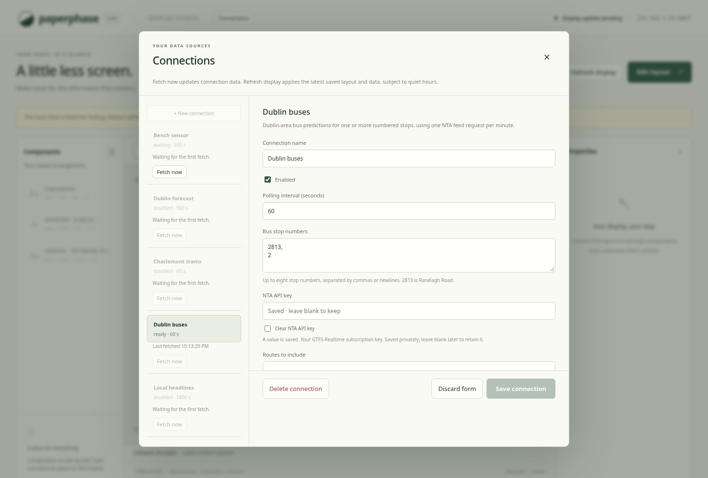
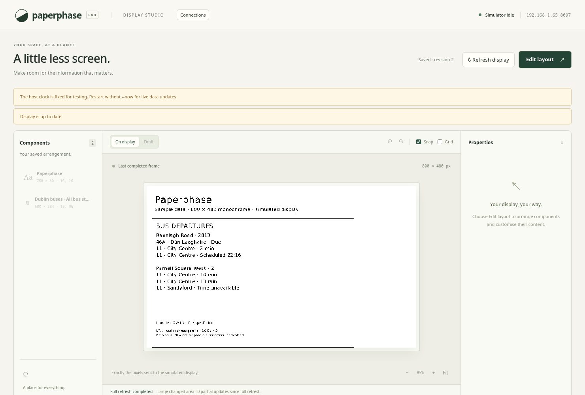
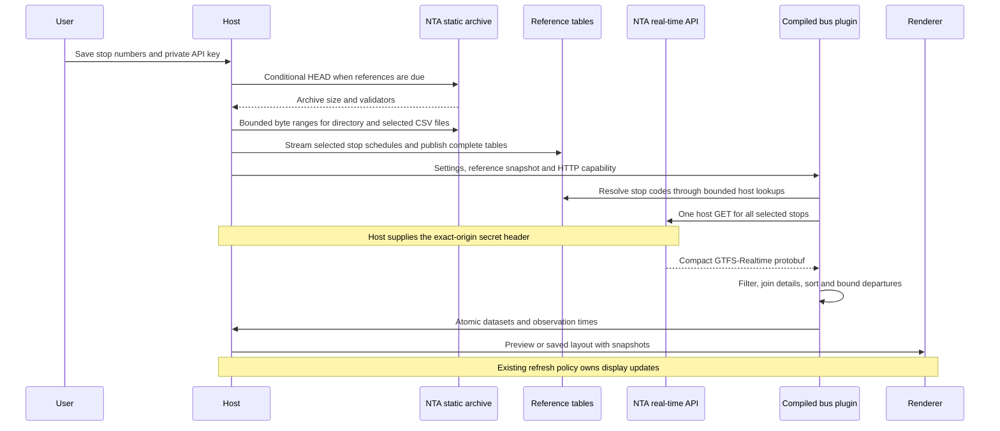

# Dublin Bus departures

`plugins/dublin-bus` is a compiled Rust/Wasm connector for numbered Dublin-area
bus stops. One NTA GTFS-Realtime download supplies every stop in a connection.
The first requested stop is **2813**, Ranelagh Road. The key is entered in the
existing private settings panel; the plugin adds no HTTP client or daemon.

## Settings and output

The settings are one to eight stop numbers, a required NTA API key, an optional
route filter and one to six departures per stop. Stop numbers accept commas or
whitespace, retain input order, normalise leading zeros and discard duplicates.
Route filters accept up to sixteen case-insensitive alphanumeric route labels.
Generic text settings now have an optional `multiline` flag for the editor.

| Dataset | Contents |
| --- | --- |
| `stops` | One row per selected stop: number, name/title, arrival text/count, details status, last update and attribution |
| `arrivals` | Retained departures: stop number/name, route, destination, expected Unix time, Dublin-local time label, minute estimate, status and observation time |
| `overview` | A combined board, last update and attribution for all selected stops |

The stop board template uses row zero of `stops`. Additional instances can bind
to other rows. The **All bus stops** template binds the combined overview. Font
sizes and element boxes remain editable; extra stops or long destination names
may require larger boxes. Normal overflow reports and non-overlap checks apply.

## Shared host services

Registration's `request_headers` maps a supported header name to a **required
secret setting ID**, for example `{"x-api-key":"api_key"}`. Supported names are
`x-api-key`, `authorization` and `ocp-apim-subscription-key`. Values are validated
as HTTP headers, marked sensitive, omitted from runtime debug output and attached
only after the normal exact-origin check. Redirects remain disabled. Browser
connection reads expose presence rather than saved secret values. Private
settings are stored using the existing restricted connection file, not encrypted.

The new `reference_lookup(table, key)` host function returns a bounded JSON array
of strings, or an absent row. No paths, SQL or network URLs are accepted. A
`RunConfig` holds an immutable `Arc<ReferenceData>` so one invocation cannot mix
old and newly imported reference tables. All connections for an identical archive
specification share its source/cache. Per-run limits are 4,096 lookups, 4 MiB of
returned lookup bytes, 192-byte keys and 4,096-byte values. A grouped lookup returns up to 64 encoded
rows within that same byte bound; ordinary CSV selections have at most sixteen
columns.

`work_budget` in trusted registration can grant up to 8 MiB of HTTP response and
500 million fuel units for a larger feed. Ordinary connectors retain their
64 KiB response and 10 million fuel defaults. Memory stays at 32 MiB per guest,
module size at 2 MiB, publication at 64 KiB and execution at one HTTP request.
The SDK's larger-buffer function requires this matching host grant.

## Reference archive cache

`reference_archive` declares one public archive URL, a local cache path, check
interval and up to eight CSV table definitions. `selection_setting` declares the text setting
whose comma/whitespace-separated keys select large-table rows. Numeric keys are
normalised; all enabled connections sharing a source contribute their selections.
Each definition names the ZIP
member, key column, selected columns and optional prefix/substring filter. The
bus registration imports:

| Table | Source and key | Values |
| --- | --- | --- |
| `stops` | `stops.txt`, `stop_code`, filtering IDs containing `DB` | Stop ID and name |
| `routes` | `routes.txt`, `route_id` | Public route label |
| `trips` | `trips.txt`, `trip_id` | Route ID, destination headsign and service ID |
| `feed` | `feed_info.txt`, `feed_version` | Version marker |
| `times` | `stop_times.txt`, paged by stop ID | Trip ID, sequence, arrival/departure and boarding type |
| `calendar` | `calendar.txt`, service ID | Weekday flags and inclusive validity dates |
| `exceptions` | `calendar_dates.txt`, service ID / date | Added or removed service |

The public stop number is looked up; the guest does not construct an ID with an
assumed city prefix. The inspected feed includes DB stop IDs from several county
prefixes. These stops can also be served by other Dublin-area operators.

A single background task checks enabled connectors. The default check interval
is one hour. A conditional HEAD/validator match reuses the existing tables. A
changed archive is read with byte ranges: end record, central directory, local
headers and selected members. Shapes are skipped. Stop times stream through
decompression/CSV parsing,
retaining only rows for the selected stops. The national stop-times table never
becomes an in-memory table.
The ZIP was about 106 MB compressed when inspected; its required compressed
metadata tables totalled about 2.2 MB. Stop times added about 39.7 MB compressed
and 391 MB of streamed CSV. This download happens on first import, archive
change or a changed set of selected stops; an unchanged hourly check is a HEAD.
Adding a stop prepares its schedule before reserving a real-time request. Existing
selections can continue using their complete previous snapshot during import.
The importer clones the runtime's existing HTTP
pool, without any invocation's authentication headers.

ZIP checks include exact Content-Range/length, consistent validators, single-disk
records, permitted compression, declared sizes and CRC-32 of expanded members.
CSV parsing streams through a bounded decompressor and retains selected columns
only. It verifies headers/row widths, key consistency and text budgets. No ZIP
paths are extracted. Only complete imports are atomically written, synced and
published; failure keeps the previous tables and retries after 60 seconds. Cached
tables are validated on restart. The service reports **Preparing reference data**
and reserves no real-time request while the first import is unavailable.

Bounds are a 1 GiB archive, 256 directory entries, 128 KiB directory, 4 MiB per
ordinary compressed member and 32 MiB expanded, with 200,000 scanned CSV rows.
An explicitly registered streaming/selected member permits 64 MiB compressed,
512 MiB expanded and eight million scanned rows. Total selected compressed data
is bounded to 72 MiB; every CSV row is bounded to 4,096 bytes. Streaming members
require a selection filter. At most 256 selected keys are admitted per source.
Reference
data permits 200,000 retained keys and 16 MiB of key/value payload across its
tables. The cache file is limited to 32 MiB. A shared 64 MiB admission budget
accounts for payload plus 96 bytes per retained row; this is an accounting limit,
not a claim about measured RSS. Imports are sequential. Replacement temporarily
holds old/new data and encoded cache bytes; Pi peak memory still needs measuring.

## Protobuf traversal and prediction semantics

The decoder follows the public
[GTFS-Realtime schema](https://github.com/google/transit/blob/master/gtfs-realtime/proto/gtfs-realtime.proto).
It traverses borrowed slices, checks varints/lengths/wire types and skips unknown
fields. It never constructs a full national-feed object graph. A header pass
requires a supported version, timestamp and full-dataset semantics. A second
pass reads trip updates and visits stop calls, bounded to 20,000 entities,
500,000 stop updates and 512 provider calls per trip. A grouped timetable lookup
identifies
selected calls per trip; route/destination lookups happen for retained selected
candidates. Candidate lists are trimmed to the configured row count.

Trips without an ID can occur in valid feed descriptors. They use their entity
ID for local deduplication and retain any available route/time information.
The exact trip ID supplies its static route/headsign. A later NTA capture used
underscore-separated descriptor route IDs where the archive used spaces, while
trip IDs still matched. The guest follows the exact trip join instead of guessing
identifier replacements. If both route IDs resolve to different public routes,
it reports conflicting details as unavailable.

Missing trip details show **Destination unavailable**, with a visible details
status. A feed-version mismatch suppresses static route/destination joins rather
than displaying potentially incorrect labels. The importer subsequently checks
for refreshed reference data.

The importer groups timetable rows into pages of at most 32, keyed as
`stop_id|page`. This avoids a single oversized value at busy stops. The guest
loads at most 64 pages (2,048 calls) per selected stop into a trip index, including
repeated stops with distinct sequences. It memoises up to 4,096 metadata lookups.
Only selected stop rows are retained by the host; the national CSV is streamed. The
guest retains at most 512 provider calls for one trip at a time. For a selected
call omitted from sparse updates, the latest earlier sequence supplies the delay.
Skipped calls do not interrupt propagation; NO_DATA and events without usable
delay stop it. Delays never propagate backwards. An upstream absolute-only event
without a delay cannot currently be propagated to an omitted downstream call.

Explicit departure time takes precedence over arrival time. When the feed
supplies only a signed delay, the connector looks up the exact trip/stop/sequence
schedule and requires a valid trip service date. Departure delay uses scheduled
departure; otherwise arrival delay uses scheduled arrival. GTFS service times use
local noon minus twelve hours plus the supplied hours/minutes/seconds, handling
Dublin daylight-saving transitions and service times beyond 24:00. The result is
a real-time prediction derived from the timetable and reported delay, separate from the scheduled fallback. Missing joins/dates or a version mismatch stay unavailable.
Past calls older than 30 seconds and predictions beyond three hours are omitted.
Undated cancellation, skipped-stop and unavailable records sort after timed
predictions. Cancelled/skipped calls are labelled explicitly; missing times do
not become `Due`. Cancellations without a matching trip/selected timetable cannot be assigned to
a stop. Sequence-only calls resolve through exact selected trip schedules. A
reassigned or skipped sequence suppresses fallback at the original stop.

Minute labels are rounded up from the feed timestamp and remain **as reported
at that update**. They are not a locally ticking countdown. Unix timestamps are
formatted in Europe/Dublin through the shared timezone code. Per-trip timestamps
can make retained data older than the feed header. The oldest retained
observation is applied conservatively to all published datasets, so one old
selected trip can mark the board stale. Future feed observations are stale under
the existing host rules. Fetch failure retains the last good publication.

A valid empty result says **No upcoming departures**, or **No matching
departures** for a route filter. If missing route metadata prevents determining
filter matches, it says **Matching predictions unavailable** instead. None of
these messages claims that no scheduled bus service exists.

## Scheduled fallback

When a trip has no usable live estimate, show **Scheduled HH:MM** using Dublin
local time. The explicit text is the marker on monochrome displays; it requires
no special icon font. `arrivals.status` is `scheduled`, `scheduled-at` contains
the timetable timestamp, and `expected-at`/`due-minutes` are null. Existing
component templates display the marker through their arrival-text binding.
Live rows retain their minute estimates and take precedence for the same trip,
service date and stop sequence. Cancellations and skipped calls suppress fallback.

For trips absent from a successfully fetched feed, scan selected-stop timetable
calls in the next three hours. Resolve service dates from the feed timestamp in
Europe/Dublin, considering the previous two days and tomorrow for overnight
service times. Apply inclusive start/end dates and weekday flags from `calendar`;
`calendar_dates` additions/removals override them. Only ordinary boarding calls
are eligible; drop-off-only and request-only calls are omitted. Route filters and
normal per-stop row limits apply. Pages never turn into an unbounded daily list.

A matching real-time trip can supply its service date for a missing estimate;
the service calendar and exceptions must still establish that the trip runs.
Unmatched/version-incompatible schedules remain unavailable. A failed API fetch
still retains last good content with the normal stale/error indicator; it does
not make the timetable a newly confirmed live arrival. No local ticking countdown
is generated for scheduled rows.

## Provider checks and validation

The [NTA portal](https://developer.nationaltransport.ie/) requires a subscription.
Its [usage policy](https://developer.nationaltransport.ie/usagepolicy) limits each
token to one request every 60 seconds. The example uses 60-second connection and
shared-origin spacing, and 120-second staleness. Several stops use one download;
separate connections share the origin spacing. Provider backoff and deadlines
remain durable and cannot be bypassed with Fetch now or settings changes.

The [static data](https://www.transportforireland.ie/transitData/PT_Data.html)
are published under CC BY 4.0. Templates include NTA attribution, its website,
licence, formatting notice and the policy's as-is/error-responsibility statement.
The [NTA upgrade notice](https://www.nationaltransport.ie/ga/news/attention-developers-upgrade-to-gtfs-realtime-api/)
warns that older static files may not match current real-time IDs, motivating the
refresh and missing-join behaviour. See the plugin's notice.

An authenticated probe on 2026-11-11 returned HTTP 200,
`application/protobuf`, 763,765 bytes and 2,204 trip updates. It contained trips
without IDs and a call at stop 2813. A second quota-spaced capture exposed
the route-ID separator difference; replaying it verified route 44 labels and
forecasts through exact trip joins. The captured data/key are not repository
fixtures; committed fixtures are synthetic. Feed size varies by time and service.

A replay of that capture with selected-stop schedules produced upcoming route 44,
38 and 38A forecasts for stops 2813 and 2. The compiled guest used 112,699,453
fuel units, 10,616,832 bytes of linear memory and about 37 ms of execution on
this desktop; compilation/import time is separate. These are one-sample desktop
measurements, not Pi capacity claims. This evidence raised the explicit bus
grant from the initial 100 million to 500 million fuel units.

Tests exercise secret headers, origin isolation, table/lookup budgets, ranged
imports, CRC/cache retention, stop lists, filters, missing details, cancellation,
malformed wire data and the actual compiled guest. Browser checks cover two stops,
private key retention, editable templates and exact preview/display equality.
The base connector passed 134 Rust tests and all 15 desktop browser flows.
Scheduled fallback raised the complete Rust suite to 138 tests; its bus browser
flow passed with exact preview/display equality and a reviewed marked timetable
screenshot. An empty-feed replay against the real archive and the final live
service both produced **44 · Enniskerry · Scheduled 23:45** for stop 2813. The final live check for 2813
returned route 44 to Enniskerry with an arrival forecast and consistent
observation times across all three datasets. Saved layout/settings were retained.
Pi performance and physical panel checks remain separate.

See [setup](../usage/dublin-bus.md).
