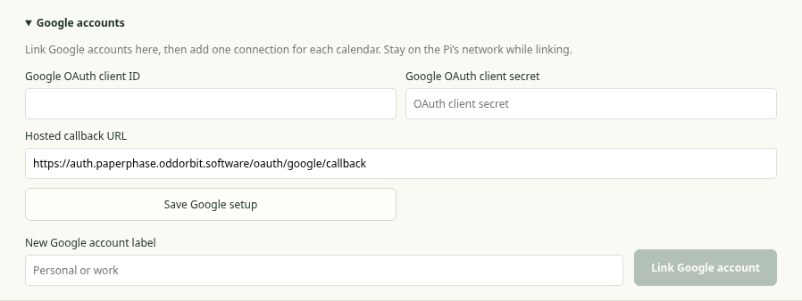

# Google Calendar

The host owns account linking, OAuth client configuration, tokens and renewal.
The Wasm plugin receives a calendar selection, privacy settings and a constrained
Google events endpoint. The host attaches an access token to requests to the
fixed `https://www.googleapis.com` origin; credentials are not guest settings or
published data. Google Calendar uses the existing shared HTTP pool, scheduling,
provider backoff, cache and display refresh policy.

## Browser callback and independent Pis

The public service is a stateless browser redirect at
`https://auth.paperphase.oddorbit.software/oauth/google/callback`. It makes no
connection to a user's Pi. Each Pi records the editor's actual HTTP authority,
an unpredictable nonce, a PKCE verifier and a ten-minute expiry. The OAuth state
contains the return address and nonce; the complete state must match a pending
record on that Pi. The verifier stays on that Pi.

```mermaid
sequenceDiagram
    participant B as Browser on the user's LAN
    participant P as That user's Pi
    participant G as Google
    participant R as Public callback relay
    B->>P: Link account from the editor
    P-->>B: Google URL, state and PKCE challenge
    B->>G: Authorise read-only Calendar access
    G-->>B: Redirect to HTTPS relay with code and state
    B->>R: Follow redirect
    R-->>B: Redirect to the originating editor's callback
    B->>P: Follow redirect on the user's network
    P->>P: Consume matching pending state; check host and expiry
    P->>G: Exchange code using client secret and PKCE verifier
    G-->>P: Tokens
    P-->>B: Return to editor without code or state
```

No fixed `paperphase` hostname, public Pi address, inbound port forwarding or
VPS-to-LAN routing is required. Different browsers can return to identical
private IPs on separate networks. Nonces and account stores are independent;
another Pi cannot accept a login state it did not create. The browser must still
reach its originating editor when it returns. A changed IP or Pi restart during
linking requires a fresh attempt. The relay permits private IPv4, IPv6 ULA,
loopback, single-label hosts and `.local` names at the exact callback path;
use a LAN IP if local name resolution is unreliable or uses another suffix.

The relay validates bounded parameters, drops duplicate/ambiguous results,
disallows arbitrary public return sites, emits no request URL logs and sends
no-store/no-referrer headers. Pending state is consumed even on denial or an
invalid host; callbacks cannot be replayed. The callback GET and top-level navigation to the public HTML editor shell may
pass the cross-site origin gate; the normal known-authority check still applies.
The callback applies the state and host checks above. All other API reads and
writes retain their same-origin checks. Allowing the final page navigation is
necessary because browsers retain cross-site metadata through redirect chains.

## Accounts and storage

Up to eight accounts share a Pi's privately configured Web application OAuth
client. Public account IDs are random stable handles; the primary calendar ID
recognises reconnections without duplicating accounts. Select one calendar per
connection, including shared calendars with reader access. Reconnect to refresh
the available calendar list. Disconnect requires removing the account's calendar
connections first; it removes local credentials, not the provider's grant.

The adjacent `workspace.google.json` file stores the client secret, access and
refresh tokens. Atomic replacement creates mode-0600 files. Public API responses
contain labels, account/calendar IDs, configuration status and the client ID,
with a secret-present flag. They never return secret/token values. Ten-minute
pending sessions remain in memory and disappear on restart.

Renewal is serialised before access-token expiry. A rotated refresh token is
saved before use. `invalid_grant` marks the account as requiring reconnection;
network failure retains credentials for a later bounded retry. A successful
link must include offline access. The only requested scopes are Calendar list
read-only and Calendar events read-only. There are no calendar write scopes.

## Linking diagnostics

`GET /api/google` exposes an optional `last_link_error` with a fixed code and
operator guidance. The callback banner and Google accounts form display that
message. It is held in memory, cleared by a new linking attempt or configuration
save, and never contains provider response bodies, URLs, state, codes, client
secrets or tokens. The service log records only the fixed failure code.
Unsolicited/replayed callbacks cannot overwrite a known attempt's diagnostic.

Calendar HTTP failures inspect bounded Google error reasons to distinguish a
disabled API (`accessNotConfigured` or `SERVICE_DISABLED`), missing scopes and
other access restrictions. Client credential rejection, invalid grants, network
failure, missing offline access and storage failure have separate guidance.
Unknown failures use a fixed generic message. The original opaque callback did
not retain its failure cause, so diagnosing an earlier attempt requires a fresh
link after deploying this reporting change.

## Events, privacy and aggregation

The guest requests expanded recurring instances ordered by start time, a bounded
1–14-day window, and at most 250 results. It normalises RFC3339 instants and
exclusive all-day end dates in the configured IANA timezone, ignores cancelled
or expired events, deduplicates event ID/start pairs and emits at most 12 events.
The `events` dataset exposes typed timestamps and display fields; `agenda`
provides an editable title/summary template. Hidden titles become Busy/Available;
hidden locations/descriptions are omitted from requested fields and published
values. Changing Calendar settings clears its old cache immediately, so a failed
fetch cannot restore previously visible private text.

The host derives `combined-agenda` for each enabled Google connection from all
enabled Google connections' cached events. It sorts by UTC start, deduplicates
matching iCalUID/start occurrences, combines source labels, and uses that
connection's timezone and event limit. A duplicate's title is hidden if any
source hides titles. The oldest source observation/success and shortest stale
interval remain attached; missing/failed calendars produce an explicit partial
availability message. Aggregation performs no provider requests.

Budgets are 256 KiB per response, 50 million guest fuel units and one event
request per invocation, with a shared 60-second Google origin floor. If a first
page cannot supply the requested display count after filtering, the guest fails
and preserves the last good data rather than treating a partial page as empty.
Accounts with more than 128 calendars or a paginated calendar list are rejected
explicitly. Full pagination is a later extension.

## Validation boundary

The full Rust check passed 164 tests; the editor build and all 20 Chromium
tests passed. Four relay tests, Docker build, Compose validation and an isolated
read-only container HTTP check passed. Local tests cover separate Pi
states/custom hosts, expiry/replay, PKCE exchange
parameters, token refresh/rotation/revocation, redaction, private file modes,
guest HTTP authentication, privacy and combined cache age. These use synthetic
accounts and local endpoints. They do not establish successful Google account
consent, production hosting, long-running token renewal, Pi resource performance
or physical screen rendering. See [setup](../usage/google-calendar.md).

### Pi and hosted callback preflight — 2026-11-15

The owner deployed the relay behind Caddy Docker Proxy; an independent public
HTTPS health check returned `ok`. The temporary Zero 2 W now runs the ARM64
Calendar build with nine registered modules. Its saved layout (revision 3) and
connection settings (revision 2) were preserved, with a private rollback backup
on the Pi. One observed service startup took 50.67 seconds, without a new memory,
CPU or long-run benchmark.

Browser checks against the Pi verified blank private client fields, the correct
prefilled callback URL, disabled linking until configured, account/calendar
selectors and state preservation after discarding a new connection form. No
Google credentials were entered and there were no page errors. This preflight
does not establish Google consent, token renewal or Calendar panel rendering.



### First live diagnostic — 2026-11-15

A fresh owner consent attempt returned the fixed `calendar_api_disabled` code.
The owner also confirmed Google's access page lists calendar listing and event
reading permissions. The Pi linked zero accounts: OAuth consent alone does not
enable Calendar API access for the Cloud project. The next operator step is to
enable Google Calendar API in the project owning the configured OAuth client,
then start another fresh linking attempt. No account/token contents were printed.
Successful real linking and renewal remain unverified.

### First successful live link — 2026-11-15

After enabling Calendar API in the OAuth client's project, the owner reported
successful linking. A redacted Pi status check confirmed one account, no linking
error and no reauthorisation flag. It did not read or expose token values,
calendar identities or event data. Multi-account fetches, long-running renewal
and physical Calendar rendering remain unverified. The planned account-linking
UX and client JSON importer are recorded in
[next plugins](../planning/next-plugins.md#later-account-linking-ux-and-client-json-import).
