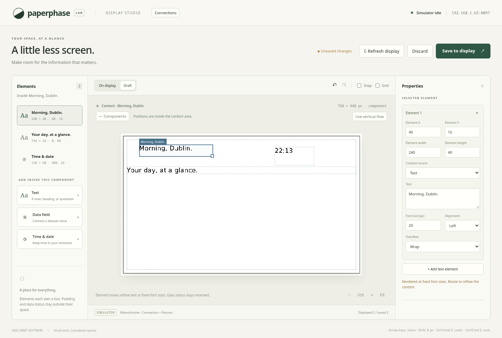
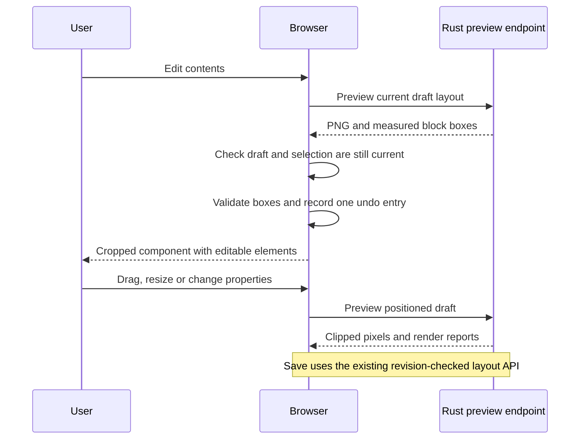

# Positioned elements inside components

The desktop editor can now move and resize individual text, data, and clock
elements inside a component. **Edit contents** opens a cropped view of that
component, with an element list and properties for the selected element.
The Rust renderer supplies all preview pixels and the initial element boxes.

This is an actual Chromium screenshot of the simulator. Selection boxes, handles,
and content boundaries are browser overlays and never enter the display image.
Icons, repeating lists, charts, plugin-supplied templates, and reusable saved
templates remain subsequent builder work.

## Model and geometry

The existing version-1 layout gains optional fields; old files still load with
their original flow behaviour. The experimental application version remains
`0.1.0`. This extends the in-development contract and does not promise that an
older executable can read a positioned layout.

| Structure | Fields and rules |
| --- | --- |
| `Component.content_layout` | `flow` by default, or `positioned` |
| `TextBlock.rect` | Absent in flow mode; required for every positioned element |
| `Component::content_bounds()` | Local rectangle after removing padding and any host data-status reservation |
| `BlockReport` | Stable block ID and measured content-local rectangle, or `null` for a hidden flow block |
| Browser edit context | Selected component ID, content-editing flag, selected element ID; separate from persisted layout |

Positioned coordinates start at the top-left of the component's **content area**.
For a component at `(cx, cy)` with padding `p`, element `(x, y)` starts at display
pixel `(cx + p + x, cy + p + y)`. Content width is `width - 2p`; content height
is `height - 2p`, less 18 pixels if any element binds a dataset field. This status
strip remains reserved even when all data is fresh.

Every element must be at least 8 × 8 native pixels and fit entirely inside that
content area. Rectangles may touch edges but may not overlap. Rust validates
bounds using 64-bit sums before allocating or drawing the frame. With at most
32 blocks per component, pairwise collision checks are bounded and simple.
The browser repeats the same geometry checks for immediate interaction feedback.

Moving an outer component moves its contents. Resizing it retains element
coordinates and sizes: shrinking, increasing padding, or changing a text source
to a data source is rejected if any box would no longer fit. Elements do not
silently shrink or move to accommodate those changes.

## Converting existing flow

Flow rendering remains unchanged: blocks use the content width and advance
vertically by measured text height plus the configured gap. The renderer also
reports each visible block's box, including glyph descenders and clipping.
Blocks beyond the content area have no box.

The browser copies these measured rectangles into the blocks and selects
`positioned`. Empty boxes receive an eight-pixel minimum height. Conversion
rejects hidden blocks, overlapping measured boxes, or insufficient space rather
than dropping content. The user can enlarge the component or adjust its text,
font sizes, and gap, then retry. A response cannot convert a draft that changed
while the request was running.

**Use vertical flow** removes the rectangles and restores block order and gap.
It is one undoable edit. Undo restores the exact positioned geometry; opening
Edit contents again resumes that arrangement.

## Drawing and interaction

In positioned mode, Rust translates each local box into display coordinates,
lays out its text at the explicit font size, and clips every glyph to that box.
Resizing reflows or truncates according to wrap/clip/ellipsis; it does not scale
the font. Data resolution, clock deadlines, warnings, and the host stale/no-data
band use the same paths as flow rendering. A new blank frame is composed each
time, so moved or removed elements leave no old pixels behind.

The browser crops the full Rust PNG to the selected component and fits it at up
to 200% zoom. Pointer deltas are divided by zoom and optionally snapped to an
eight-pixel grid. Each gesture retains its initial layout and last valid box.
An invalid proposal is red; release keeps the last valid box. Escape or pointer
cancellation restores the initial layout. No neighbouring box moves.

Numeric placement, arrow keys, Shift-arrow movement, undo/redo, Save/Discard,
and current-versus-draft views follow the outer editor's rules. Delete removes
the selected element but preserves the required last element. Escape clears
element selection, then returns to the component view. New text/data elements
scan eight-pixel positions for a free box up to 128 × 30 pixels; clocks use
128 × 60. Failure leaves the arrangement intact and asks the user to make room.

## Validation

The complete Rust check script passed on x86-64 Linux: 79 tests, formatting,
host/guest Clippy, and the compiled guest build. New model tests cover required
rectangles, collisions, touching edges, minimum size, integer overflow, padding,
status reservation, and shrink rejection. Renderer tests verify identical pixels
after measured conversion, clipped painting, cleared old positions, and reports
for hidden flow blocks.

All nine Chromium flows passed. Internal editing exercises conversion, drag and
resize, invalid-drop recovery, numeric and keyboard placement, history, adding
data/clock elements, removal, flow restoration, shrink rejection, saved preview
equality, reload persistence, hidden-block feedback, and the reserved status area.
The screenshot waits for the matching preview response. Pi performance, Google
accounts, and physical-panel behaviour remain separately unvalidated.

See [operator instructions](../usage/desktop-editor.md#edit-inside-a-component).
