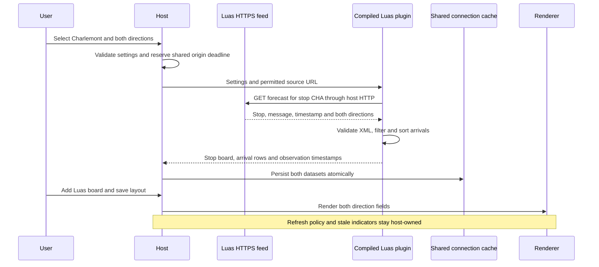
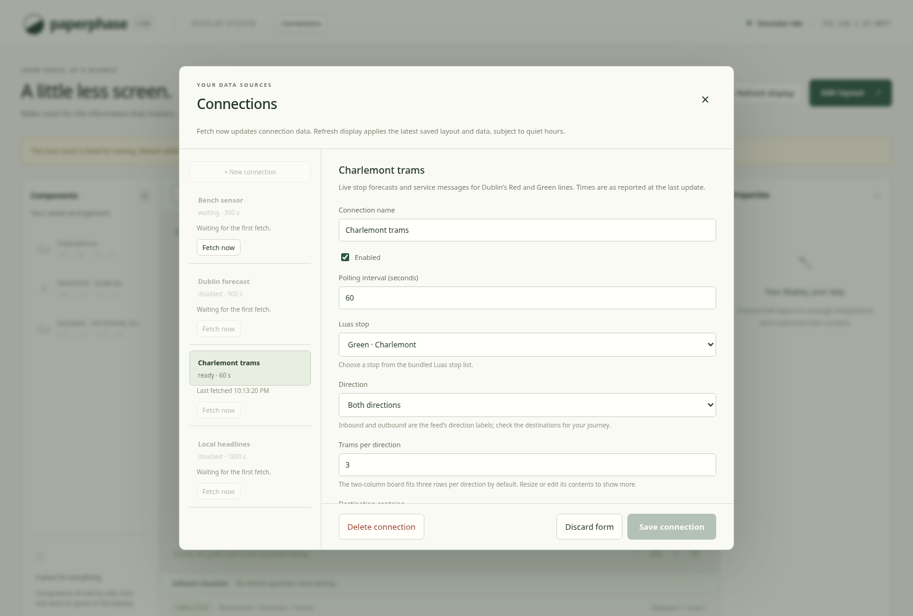
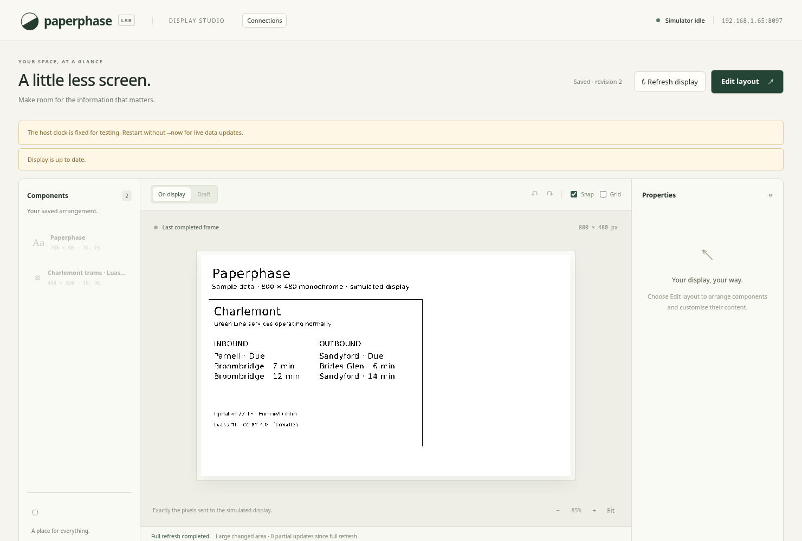
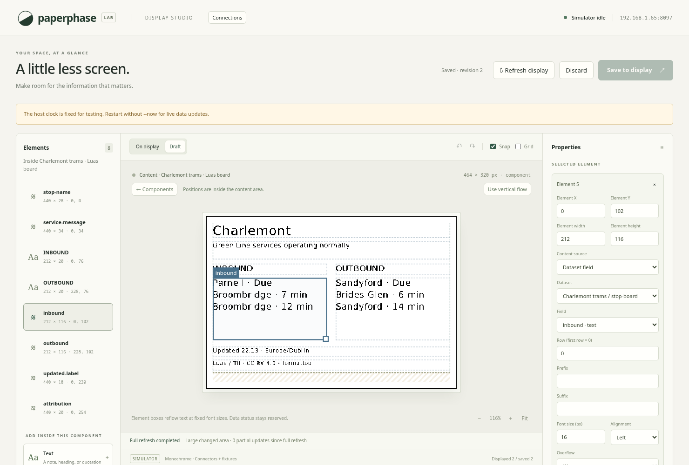

# Luas departures

`plugins/luas` is a compiled Rust/Wasm connector for Luas stop forecasts. One
host-supplied HTTPS GET returns both directions and the service message. The
plugin does not contain an HTTP client or draw its own display pixels. Its
settings and templates use the existing generic connection/editor paths.

The first live setup is Charlemont (`CHA`), both directions. The bundled selector
contains the 67 stops returned by the provider's `action=stops` response on
2026-11-11. Stop metadata belongs to the plugin in `stops.json`; the current
experimental definitions/templates remain in the shared connector catalog.

## Settings and data

Settings are stop code, direction (`both`, `inbound`, `outbound`), one to six trams
per direction, and an optional case-insensitive destination substring. Both
directions and three trams each are the defaults. Stop choices include the line
and stop name. Generic choice settings now permit up to 128 entries, within the
existing total catalog byte budget, to accommodate the complete stop list.

| Dataset | Structure |
| --- | --- |
| `stop-board` | One row with stop name/code, line, selected direction label, service message, update label, per-direction text, combined board text, total retained arrival count and attribution |
| `arrivals` | Zero to twelve rows with direction, destination, nullable numeric `due-minutes`, display `due-label`, status and stop code |

`Due` and numeric zero publish zero minutes with status `due`. Other valid
non-negative integer forecasts publish `expected`. Missing/unrecognised times
retain the destination with null minutes, `Time unavailable` and status
`unknown`; they never become zero. Sorting is stable by numeric minutes, with
unknown times last, separately within each direction. Inbound rows precede
outbound rows in the combined dataset. Equal forecasts remain separate because
they may represent distinct trams.

The provider's empty terminal placeholder (`destination="No trams forecast"`,
empty `dueMins`) contributes no arrival. Valid empty forecasts replace the prior
arrivals with zero rows and keep the service message in the summary. Destination
filters can instead produce `No matching trams forecast`. A direction excluded
by settings publishes `Direction not selected` in its summary field. A missing
platform/direction produces no forecasts, not an invented arrival. The service
message is displayed verbatim after whitespace normalisation; it is not
interpreted as a guarantee of normal service.

## Parsing and freshness

1. Build the forecast query from the selected stop code, clearing old query
   parameters. Only the registered origin is permitted by the host.
2. Parse UTF-8 XML with a bounded event reader. Require one `stopInfo` root,
   exactly one message and at least one recognised direction. Verify the returned
   stop code matches the request. Allow empty trams/directions and a single
   platform. Decode standard character/entity references and message CDATA.
3. Reject malformed/truncated/trailing XML, DTDs, processing instructions,
   duplicate directions/attributes, unexpected nested content, wrong stops and
   invalid timestamps. Limits are 64 KiB input, 4,096 events, 128 trams, three
   open elements, 32 attributes per element, 1,024-byte attribute/message values
   and 128-byte destinations. Normal publication/output budgets also apply.
4. Interpret the offset-free `created` timestamp as `Europe/Dublin`. This is an
   integration assumption consistent with the inspected live response, not a
   timezone field supplied by the API. Reject skipped local times. During an
   autumn overlap choose the earlier instant so uncertain data goes stale early.
5. Publish the board and arrivals together, with the same provider observation
   time. The renderer retains the provider's minute values between fetches;
   it does not decrement estimates from an old payload.

`Publication.additional_observed_at` is a new optional map from additional
**dataset ID** to Unix observation time. Keys must refer to declared additional
datasets; at most seven entries are allowed. The runtime passes it through and
the host persists it on each corresponding snapshot. Omission preserves the
existing fetch-time semantics for forecast datasets such as weather's future
hourly/daily values. Legacy publication calls remain unchanged. Luas uses this
map so a newly fetched old feed is stale in both datasets. Each snapshot uses
the older of provider/fetch time; future observations also remain stale.

The example registration defaults to 60-second polling and a 60-second shared
origin spacing, with data stale after 120 seconds. These are conservative project
settings, **not a published Luas quota**. Multiple stops share that origin budget,
so each may update less often than its requested interval. The scheduler ranks
eligible work by its own polling deadline before applying ID tie-breaking; a
shared origin deadline cannot let the first connection monopolise every slot.
Polling/backoff metadata survives restarts, and Fetch now cannot bypass it.
Failure retains both datasets and marks them stale. Quiet hours affect display
updates, not fetching.

## Templates and editor

The main 464 × 320 board places inbound/outbound text in separate columns, with
the stop, service message, update time and attribution shared above/below them.
A narrower 320 × 288 template uses a combined vertical board. Both default to
three trams per direction. Larger row counts or long destinations may require
resizing/editing the element boxes; overflow is reported, not silently scaled.
Normal geometry validation prevents overlaps and protects the host status strip.

## Provider evidence and limits

The [official TII dataset listing](https://data.gov.ie/en_GB/dataset/luas-forecasting-api)
describes the stop forecasts and licenses the dataset under CC BY 4.0. The
[HTTPS forecast](https://luasforecasts.rpa.ie/xml/get.ashx?action=forecast&stop=cha&encrypt=false)
and [stop list](https://luasforecasts.rpa.ie/xml/get.ashx?action=stops&encrypt=false)
were inspected directly. HTTPS responded without a redirect or API key. Terminal
responses supplied an explicit empty placeholder. See the plugin's
[notice](../../plugins/luas/NOTICE.md) for source and transformation attribution.

No numeric polling allowance or service availability guarantee was found in the
published listing. Confirm current provider guidance before wider deployments
or increasing request frequency. This integration uses the dedicated Luas feed;
it does not depend on the separate deprecated general RTPI service or implement
NTA GTFS-Realtime, buses, DART, journey planning or historical arrival storage.

## Validation

Unit coverage includes both directions, sorting, unknown/due/empty states,
filters, XML errors/budgets, stop identity, selector consistency and Dublin DST.
Compiled guest tests exercise the actual sandbox, one host request and fuel
budget. Cache tests verify atomic replacement, persisted observation times,
old-payload staleness and last-good retention after failure. A scheduler regression
checks fairness at a saturated shared origin. Browser coverage checks the stop
selector, both-direction settings, templates, editable bindings, persistence and
exact preview/display equality. The complete script passed 117 Rust tests,
formatting, host/guest Clippy and four Wasm builds. TypeScript/frontend builds and
all 14 Chromium flows passed. The diagram and actual screenshots were reviewed.
A live Charlemont request through the compiled plugin returned both directions,
six retained rows and matching observation times on 2026-11-11. The local service
kept its existing saved layout while adding the new connection. Desktop checks
do not establish Pi performance or physical panel behaviour. See the changelog.

See [setup and operation](../usage/luas.md).
