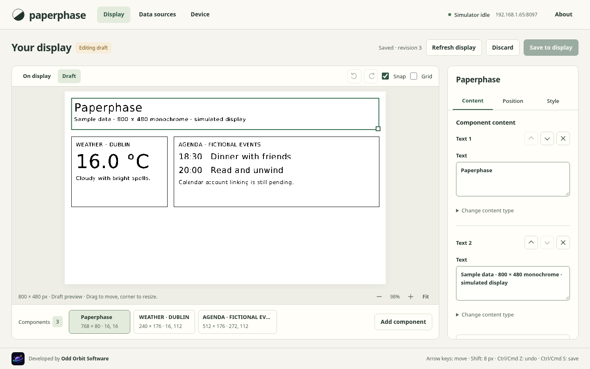
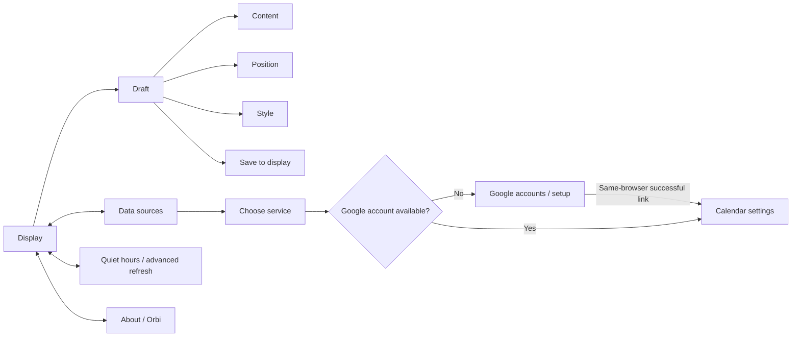

# Owner workspace

The `UIUX` branch implements the owner's approved canvas/task-dock direction.
The local browser remains a client of the existing Rust layout, preview,
connection and Google APIs; the redesign does not change persisted schemas.
Paperphase retains its warm paper/green identity. See [DESIGN.md](../../DESIGN.md)
for normative styling tokens and [the direction contract](../planning/uiux-direction.md)
for the accepted scope.

Actual local screens: [data sources](images/uiux-sources.png),
[Google accounts](images/uiux-google-accounts.png),
[Google prerequisites](images/uiux-google-setup.png),
[Device](images/uiux-device.png), [element editor](images/uiux-elements.png),
[About](images/uiux-about.png) and [narrow-screen reflow](images/uiux-mobile.png).
Accounts/providers are synthetic; screenshots do not show private credentials.

## Navigation and state

Top navigation exposes Display, Data sources, Device and About. Display keeps a
large monochrome frame, a right inspector and a horizontally browsable component
strip below. At narrower effective desktop widths the inspector stacks below
rather than pushing controls out of the viewport. The display itself remains a
scaled two-dimensional surface. Full phone editing is not a release commitment.

`currentPage` controls which working section is visible. The Data sources
container uses a nonmodal `dialog.show()` with normal document flow: navigation
remains accessible and the task occupies a full page. Only destructive
confirmations use `showModal()` with protected focus and a cancel-first action.
Connection form changes block navigation until saved/discarded; display drafts
remain in memory when visiting another page. Device starts a display draft when
needed. Saving or discarding returns to Display.

Display editing still uses a cloned `Layout` and `RefreshSettings`, one shared
undo/redo history and explicit save/discard. Last displayed pixels and draft
preview remain separate. Content mode, component selection and element selection
retain their content bounds; internal items may overlap, while whole components
keep the non-overlap rule.

## Content and precision editing

Content is the initial inspector tab. Literal text is editable immediately,
without converting its flow layout. Content type changes are disclosed separately.
Position holds pixel geometry and the deliberate **Position elements freely**
action; the explanation identifies conversion into element boxes. Existing
positioned components expose **Edit individual elements**. Style holds typography,
alignment, overflow, component naming, spacing, border and advanced refresh hints.

The component picker contains text, data and clocks, then templates grouped by
saved source with paused/plugin-unavailable context. Successful insertion closes
the picker. Failure retains it and explains the required free space. Component
design before placement remains separate planned work.

## Focus and asynchronous updates

`retainFocus` captures the initiating control's logical identity, text selection
and disclosure state around necessary subtree redraws. IDs identify static
controls; visible accessible labels plus component/element/block scope identify
rendered controls. Labelled change handlers retain their originating node during
blur-triggered changes, when the browser may already report BODY as active.
Tab records the intended next logical control and restores it after the native
blur/redraw completes. Focus restoration avoids scrolling the work away.

Connection polling updates fetch details/buttons in place while configuration
revision is unchanged. It does not reconstruct a focused source list every
second. Canvas/list accessible names use visible component or element names,
while internal IDs remain in data attributes for stable model identity.

## Data sources and Google

Add data source opens a service chooser. Real services lead; demo/example
connectors live under Advanced. Schema-driven fields retain all existing typed
controls and secret semantics. Related settings use a two-column group where
space permits; multiline/table/secret inputs use full width. Weather forecast
options are disclosed separately. Saved-source deletion and account disconnect
require named confirmations explaining consequences.

Google account linking has a separate view. Existing app credentials move behind
Advanced after setup. Selecting Calendar without an account opens prerequisites
before creating a connection draft. A successful same-browser link resumes the
calendar task using a non-secret `sessionStorage` intent marker containing only
`calendar.google`. Account access tokens and OAuth credentials remain on the
host; no credential values are put in that marker. Navigation to Google still
requires saving/discarding layout and connection drafts.

Shared public OAuth and client JSON import are not added here. The callback,
PKCE, account isolation and server-side secret handling retain the existing
[Google design](google-calendar.md).

## Loading and recovery

Workspace state is essential. Catalog, timezones, connector definitions,
connections and icon packs load with `Promise.allSettled`; failed optional
metadata leaves the frame/editor available and offers Retry options. Initial
workspace failure hides nonfunctional preview chrome and offers Retry connection.
A transient polling outage retains the last completed frame and draft.

## Branding and assets

The persistent footer reads **Developed by Odd Orbit Software** and uses the
approved logo at 32 × 32 px. About carries a larger maker card and the approved
Orbi portrait; routine editing contains no mascot. Exact source origins and
usage constraints are in [the asset README](../../web/assets/brand/README.md),
with origin metadata also embedded in each PNG. Rust embeds and serves the
images locally; About's portrait loads lazily. No remote fonts or image service
are required, and the frontend bundle does not include the portrait bytes.

## Verification boundaries

Browser coverage includes existing editing/plugin flows and targeted regressions
for selection/Tab/movement/polling focus, preserving flow on content edits,
optional metadata retry, initial failure retry, destructive confirmation,
Google prerequisites and narrow-width access. Fixture accounts/providers are
synthetic. Desktop checks do not establish Pi resource use, real Google consent
or physical display behaviour. Those validations remain separate.

The subsequent [component designer](component-designer.md) extends this system
with plugin-specific designs before placement, saved designs and restored
mouse-selected deletion.
