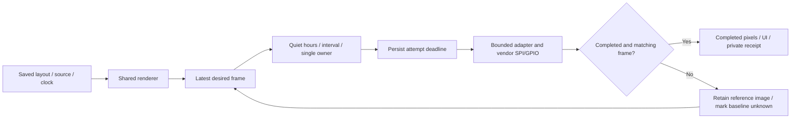
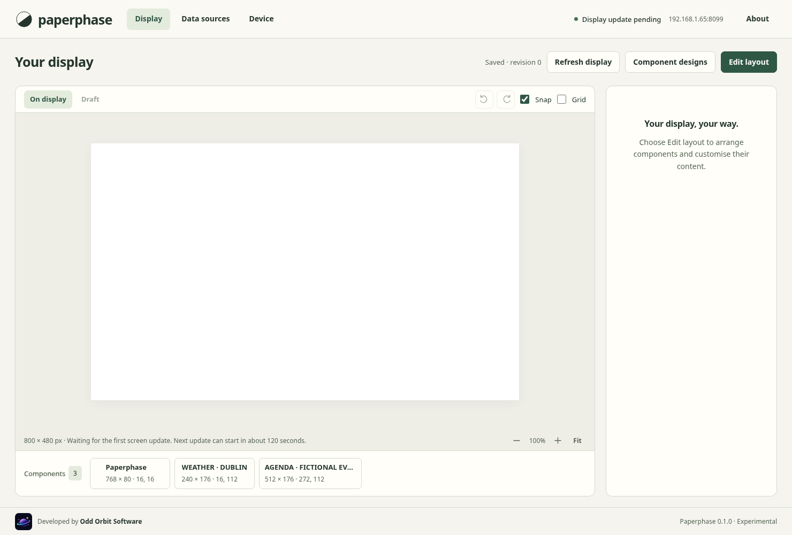
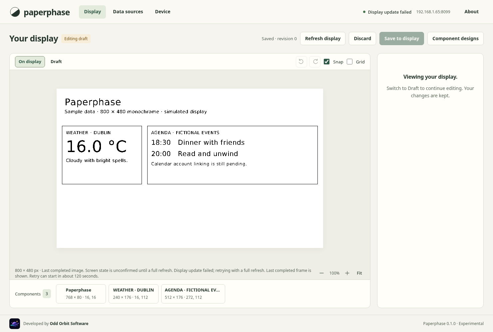

# Physical display backend

The explicit `--display waveshare-v2` backend connects the shared compositor and
refresh worker to the owner's monochrome Waveshare 7.5-inch V2 / Rev2.3 HAT.
The default remains `simulator`; opening the desktop editor never probes GPIO.
This first hardware profile supports full refresh only. Partial/fast refresh and
long-term maintenance/ghosting qualification remain separate work.

## Execution and acknowledgement

The Rust driver owns the shared `/tmp/paperphase-waveshare-v2.lock` for its
lifetime, preventing another service or the one-shot smoke tool from using the
panel concurrently. One worker executes at a time, outside the workspace mutex.
It transfers an exact 800×480 PBM through an embedded bounded Python adapter and
the separately installed, fingerprint-checked vendor reference. The interpreter
is isolated and disables bytecode writes. Each invocation gets a private writable
working directory because lgpio creates notification files in its working directory.

The adapter uses the proven BCM GPIO mapping and four-wire SPI0/CE0 at 4 MHz.
Every BUSY wait is bounded to 20 seconds; the Python operation budget is 75 seconds,
with an 80-second parent watchdog. A refresh must observe BUSY, complete sleep and
release power/GPIO. Acknowledgement includes the exact packed-frame SHA-256.
Failures retain the previous completed image and require full recovery. The
watchdog reaps stalled children and attempts bounded emergency power release.
The inherited stdin lock keeps ownership through an abrupt parent exit until the
worker ends; BUSY waiting also detects a lost parent.

## Conservative profile and restart recovery

`waveshare-7.5-v2-full` enforces at least 180 seconds after completion, with a
180-second retry floor. Component partial preferences cannot override the profile.
Unchanged pixels still skip hardware work once the baseline is known. Saves,
background fetches and clock deadlines reuse the existing desired/completed queue;
missed intermediate changes are not replayed. Quiet hours stop new operations,
while an already active operation may finish.

A private adjacent `workspace.display.json` journal stores a restart deadline and
an optional completed record: layout, revision, packed-frame base64 and completion
time. Before energising the panel, an atomic write reserves the interval plus the
maximum operation budget. Failure to write this record prevents hardware access.
After hardware success, memory acknowledges the actual completed image even if
writing the new receipt fails; a separate recovery-storage warning reports that
condition. The previous persisted record remains conservative for restart.

On restart the hardware baseline is unknown. A valid receipt supplies a labelled
last-completed reference image, not a claim of optical readback. With no receipt,
`display_frame_available` is false and the editor hides the unconfirmed image.
The controller honours the journal deadline, then requires a successful full
refresh. `/api/state` distinguishes physical/simulated mode, image availability,
recovery warnings, pending work and completed operations.

SIGINT and SIGTERM stop new work and wake waiting workers. An active bounded
operation drains before process exit. The systemd unit uses `KillMode=mixed` and
a 100-second stop timeout so SIGTERM does not prematurely interrupt the adapter.

## Vendor basis and validation limits

The driver package is pinned to Waveshare commit
`d28b3c4cfc78eef1c6cd6e6e3013654e449d2864`; upstream license notices stay with it.
The [vendor manual](https://www.waveshare.com/wiki/7.5inch_e-Paper_HAT_Manual)
recommends conservative full-refresh spacing and sleep between operations.
The [pinned reference](https://github.com/waveshareteam/e-Paper/blob/d28b3c4cfc78eef1c6cd6e6e3013654e449d2864/RaspberryPi_JetsonNano/python/lib/waveshare_epd/epd7in5_V2.py)
provides the electrical sequence. Merely exposing a partial-refresh method does
not validate it on this individual panel.

Desktop tests use fake workers/vendor modules for exact frames, clipped output
independence, BUSY/parent loss, cleanup, watchdog, storage ordering and recovery
acknowledgements. Simulator scheduling and browser-state checks remain separate
from Pi electrical results and the owner's visual confirmation.

## Observed Pi result

On 2026-11-15 the boot-enabled service completed startup, source-driven and
timed clock full updates. The first refresh took 5.743 seconds (8.670 seconds
for the complete adapter operation); the owner confirmed a readable image.
Five successive measured full refreshes were 5.740–5.744 seconds and were
spaced approximately 189 seconds apart including the operation. A graceful
restart restored the reference image, kept its cooldown, and required a full
recovery before acknowledging the restored layout. The temporary clock was
removed and the original layout was preserved exactly.

See [validation detail](../usage/foundation-harness.md#automatic-physical-display-results--2026-11-15).
These short full-refresh observations do not validate partial updates, physical
quiet-hours transitions, power interruption or long-term ghosting.

## Editor states

These are actual compiled-editor captures with a synthetic layout and mocked
physical status, not photographs or evidence of panel output. The existing
paper/green design system is preserved. Eligibility and retry messages appear
beside the preview, including on mobile; advanced refresh controls remain in
Device settings. The Impeccable finish reviewer scored the one requested fix
(visible cooldown/retry explanation) resolved across desktop, laptop and mobile.

