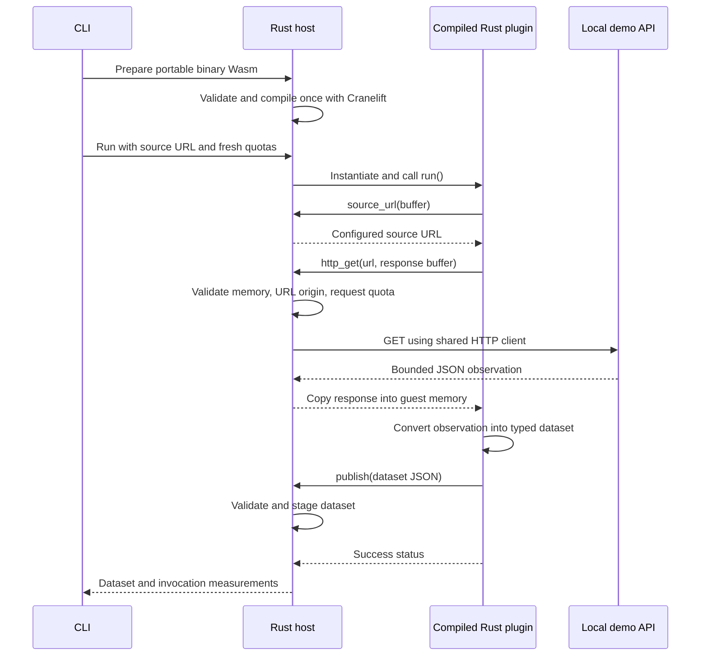

# Compiled plugin foundation

Status: implemented validation harness. This is the first part of foundation
validation, not a completed plugin platform or a final SDK contract.

## Implemented pieces

| Package | Responsibility |
| --- | --- |
| `paperphase` | CLI, deterministic local API, and JSON benchmark report |
| `paperphase-core` | Shared dataset, layout, snapshot, and validation types |
| `paperphase-runtime` | Native Wasm compilation, invocation limits, shared HTTP client, dataset validation |
| `paperphase-plugin-sdk` | Rust guest wrappers for the experimental host imports |
| `paperphase-temperature-example` | Fetch an observation and publish a typed temperature dataset |

Wasmtime 48.0.8 is the runtime under evaluation. Cranelift is selected explicitly;
there is no interpreter fallback. Disable Wasmtime's default feature set and
enable its standard library, runtime, and native compiler features. The presence
of internal Pulley support crates in the dependency tree does not select the
Pulley execution backend.

The host uses one blocking Reqwest client and shares its connection pool across
invocations. TLS uses an explicit Rustls/ring configuration and native trust
roots. No guest contains an HTTP client, TLS implementation, or socket access.
Redirects, environment proxies, and automatic retries are disabled in this
harness so the origin grant and request count remain explicit.

## Execution flow



`prepare` accepts binary Wasm only, with a module-size check before compilation.
It returns a `PreparedPlugin` containing compiled machine code. Repeated runs
reuse it; they do not recompile the module. Native caches supplied by publishers
are never deserialised. Persistent compilation caches are not implemented yet.

Each run gets a fresh `Store`, guest state, memory/table limits, and request
counter. Set fuel before instantiation because Wasm start functions also execute
untrusted instructions. Link only the three host functions below. A module
requiring WASI or other undeclared imports fails instantiation.

## Experimental `paperphase_v0` ABI

The guest exports `memory` and `run() -> i32`. Zero means success. All pointers
and lengths refer to its 32-bit linear memory; no Rust object crosses the ABI.

| Import | Arguments | Result |
| --- | --- | --- |
| `source_url` | Destination pointer, capacity | Number of URL bytes written |
| `settings_json` | Destination pointer, capacity (at most 16 KiB) | Connection settings JSON bytes written |
| `http_get` | URL pointer/length, response pointer/capacity | Number of response bytes written |
| `publish` | JSON pointer/length | Zero after validating and staging a dataset |

Host failures trap the invocation. The final API will need structured connector
errors; this harness deliberately does not define their stable representation.

For every buffer, convert signed arguments to non-negative offsets, check the
host byte limit, use checked addition, and verify the entire range against the
current guest memory. Validate an HTTP output buffer before starting a request.

The configured source grants its exact origin: scheme, hostname, and effective
port. Reject other origins and URLs containing credentials or fragments. This
is an origin grant, not a path or resolved-IP policy. Plain HTTP is allowed for
explicitly configured local sources. Production permission design remains open.

Read HTTP bodies through a `capacity + 1` byte limit, also capped by the host's
response budget. The extra byte detects oversized responses even without
`Content-Length`. The client deadline covers both headers and body reads. CPU
fuel does not replace host-operation timeouts.

`publish` accepts one dataset per invocation. Keep it staged until `run` returns
success. A later trap or nonzero status discards it with the store. A failed
invocation therefore cannot return a partially successful update.

## Data structures

| Record | Fields |
| --- | --- |
| `RunConfig` | Parsed source URL, permitted origin, bounded connection settings |
| `RunAttempt` | Invocation result and isolated provider backoff/retry hints |
| `Limits` | Guest memory/fuel, module/response/output bytes, request count/deadline |
| `Dataset` | Schema version, ID, field definitions, rows |
| `Field` | ID, type (`text`, `number`, `boolean`), optional unit |
| `RunMetrics` | Elapsed milliseconds, consumed fuel, request count, guest memory bytes |

Dataset schema version 1 is provisional. Each row must contain exactly the
declared fields. Values must match their types; explicit nulls represent missing
values. Empty row lists are successful empty results. Reject duplicate fields,
unknown properties, invalid IDs, nested values, and oversized data.

The example receives `{"temperature_c":18.5}`. Its current output with default
settings is:

```json
{
  "schema_version": 1,
  "id": "current-weather",
  "fields": [
    {"id": "temperature", "kind": "number", "unit": "celsius"},
    {"id": "display-temperature", "kind": "text"},
    {"id": "location", "kind": "text"}
  ],
  "rows": [{"temperature": 18.5, "display-temperature": "18.5 °C", "location": "Observation"}]
}
```

## Initial harness limits

These are executable test budgets, not measured production defaults.

| Resource | Limit |
| --- | --- |
| Portable module | 2 MiB |
| Guest linear memory | One memory, at most 32 MiB |
| Guest stack | 512 KiB |
| Tables | One table, at most 4,096 elements |
| Wasm execution | 10,000,000 fuel units per invocation |
| HTTP | Four attempted requests, three-second deadline per request |
| HTTP response / published JSON | 64 KiB each |
| URL | 8,192 bytes |
| Settings JSON | 16 KiB |
| Dataset | 1–32 fields, at most 512 rows |
| IDs / units / text values | 64 / 64 / 4,096 bytes respectively |

Fuel is an execution budget, not milliseconds. Linear-memory limits do not cap
whole-process RSS, compilation memory, native stacks, or all host allocations.
The CLI retains invocation metrics and only the final dataset during repeated
runs, rather than retaining every payload.

The [service connection layer](compiled-connectors.md) reuses this runtime with
one HTTP attempt per invocation and a shared polling/backoff gate. The example
also reads location/units settings and accepts null temperature as an empty
result. Older guests using only the original imports remain compatible; the
updated example requires `settings_json`.

## Validation

The 18 boundary tests cover actual compiled guest fetching/transformation,
typed/empty results, request reset, denied origins, redirects, request quotas,
streamed body limits, stalled headers/bodies, fuel exhaustion, start-function
limits, memory/table growth, invalid buffers, publication limits, unavailable
WASI imports, malformed modules, and cross-runtime misuse. Healthy invocations
are checked after guest and upstream failures.

Compiled-guest tests are explicitly ignored in ordinary `cargo test` until a
guest artifact is supplied. `scripts/check.sh` builds it, supplies its path, and
runs the suite including those tests. GitHub Actions runs this script.

Local execution used x86-64 Linux. The shell blocks loopback sockets, so the
integration test executable ran in a read-only, unprivileged container with no
external network and a writable temporary directory. All 18 tests passed.
Formatting and Clippy checks also passed. These results do not validate the Pi.

## Remaining foundation work

- Measure release execution and installation/compilation costs on a Zero 2 W.
- Add compilation resource limits before accepting arbitrary community packages.
- Define stable packages, settings, credentials, capabilities, templates, schema
  evolution, and structured errors. Origin grants alone are not the final policy.
- Validate Google account linking and token renewal with real credentials.
- Confirm the panel revision and validate physical refresh behaviour.
- Implement persistent native caches with runtime/configuration compatibility.

The [shared model and renderer](data-and-rendering.md) now extend this foundation
with a separate file-based simulator. Layout editing, persistence, historical
storage, provider polling, installation, and hardware drivers remain pending.
The local API is a deterministic fixture, not a weather-provider integration.

## References

- [Wasmtime interruption](https://docs.wasmtime.dev/examples-interrupting-wasm.html)
- [Wasmtime store limits](https://docs.rs/wasmtime/48.0.8/wasmtime/struct.StoreLimitsBuilder.html)
- [Wasmtime precompilation and trust](https://docs.wasmtime.dev/examples-pre-compiling-wasm.html)
- [Reqwest client configuration](https://docs.rs/reqwest/0.13.5/reqwest/blocking/struct.ClientBuilder.html)
