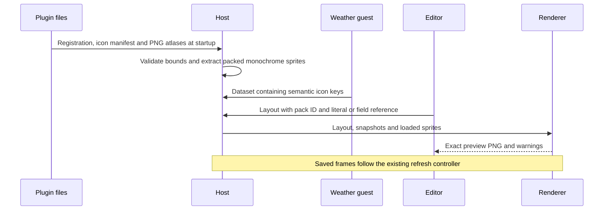
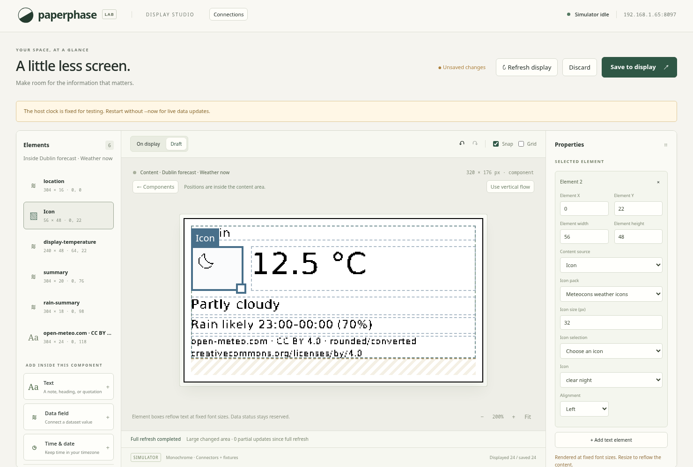

# Plugin-owned icons

Weather artwork and condition mapping live in `plugins/weather`. The host has a
shared PNG loader and icon renderer, with no weather-specific artwork, code
mapping, SVG engine, or image network requests. Assets are local companion files
to a registered Wasm module. UI package installation remains future work.

## Data structures

`TextSource::Icon` extends the existing element source union. It stores
`pack_id`, a square pixel `size` (8–256), and `IconReference`. The reference is
either a literal `icon_id` or a normal `Binding` to a text field. Icon bindings
cannot use decimal places, prefixes or suffixes. Existing text layouts and
legacy weather `symbol` fields remain supported.

An icon occupies its existing flow or positioned element box. Position, size,
alignment, collision checks, history and save behaviour use the same editor
paths as other elements. A bound icon reserves the host data-status strip and
participates in freshness scheduling even when it is the component's only data
binding. Icon size is independent of the box and never shrinks automatically.

Each `icons.json` has `schema_version: 1`, pack `id` matching its connector ID,
a display `name`, `variants: [{size, image}]`, and
`icons: {semantic_key: {column, row}}`. Each variant is a grid of square cells of
its declared size. Rows/columns are zero-based. Layouts contain IDs rather than
paths; the manifest resolves PNG paths relative to its own directory.

`IconStore` indexes `(pack_id, icon_id)` to pre-extracted `Sprite` variants.
Each sprite stores its native size and MSB-first, row-padded one-bit pixels.
`GET /api/icon-packs` supplies IDs, names, icon keys and native sizes to the
editor. Artwork is loaded at service startup, not sent through guest publication
buffers or decoded for each render.

## Loading and drawing

1. Validate the manifest and canonical image paths. Reject parent traversal,
   absolute image paths, symlink escapes, invalid IDs, duplicate sizes, animated
   PNGs and cells outside the atlas.
2. Decode each PNG once. Expand palettes/transparency and reduce 16-bit channels.
   A pixel becomes black when alpha is at least 128 and weighted RGB luminance
   is below 128. Other pixels leave the white background untouched.
3. Select the closest native size for the requested size, preferring the larger
   variant on a tie. Scale with nearest-neighbour sampling and draw only the
   visible intersection of the icon square and its element clip.
4. Resolve bound keys through the existing snapshot/freshness machinery. A
   successful empty dataset draws no icon. Missing assets show `?` and a
   `missing_icon` warning. Invalid field types produce `incompatible_format`.
   Stale snapshots retain their icon and receive the normal status indicator.

Limits are 64 KiB per manifest, 1 MiB and 4,194,304 pixels per atlas, 128 icons and
8 variants per pack, 32 MiB decoder allocation budget, and 8 MiB of extracted
pixels across registered packs. Existing registration, layout and render-slot
limits also apply. No display refresh capability is inferred from these assets.

## Weather artwork and keys

The approved pack uses static monochrome
[Meteocons by Bas Milius](https://github.com/basmilius/meteocons), distributed
under MIT. Original selected SVGs, the upstream licence and pinned npm package
provenance are included under `plugins/weather/assets`. The offline build helper
rasterises 16, 24, 32, 48 and 64 px variants and thresholds alpha once. The running
service needs only the generated PNGs and manifest. It does not need a browser.

[Open-Meteo](https://open-meteo.com/en/docs) supplies WMO condition codes, not
icon artwork. The guest publishes
`icon-key` in current, hourly and daily datasets. Current and hourly clear/cloud
variants use the provider's `is_day`; daily summaries use day variants. Unknown
codes or missing day flags for day-dependent conditions use `unknown`.

| Codes | Semantic keys |
| --- | --- |
| 0 | `clear_day`, `clear_night` |
| 1 | `mainly_clear_day`, `mainly_clear_night` |
| 2 | `partly_cloudy_day`, `partly_cloudy_night` |
| 3 | `overcast` |
| 45, 48 | `fog`, `fog_rime` |
| 51, 53, 55 | `drizzle_light`, `drizzle_moderate`, `drizzle_heavy` |
| 56, 57 | `freezing_drizzle_light`, `freezing_drizzle_heavy` |
| 61, 63, 65 | `rain_light`, `rain_moderate`, `rain_heavy` |
| 66, 67 | `freezing_rain_light`, `freezing_rain_heavy` |
| 71, 73, 75, 77 | `snow_light`, `snow_moderate`, `snow_heavy`, `snow_grains` |
| 80, 81, 82 | `rain_showers_light`, `rain_showers_moderate`, `rain_showers_heavy` |
| 85, 86 | `snow_showers_light`, `snow_showers_heavy` |
| 95, 96, 99 | `thunderstorm`, `thunderstorm_hail_light`, `thunderstorm_hail_heavy` |
| 97 (extended mapping) | `thunderstorm_heavy` |
| Other/null | `unknown` |

There are 33 semantic keys. Some share artwork: rime fog uses fog, freezing
precipitation uses sleet, and several rain/snow severities use cloud variants.
Shower artwork is the pack's day-style drawing. These are presentation choices,
not additional weather measurements. `assets/sources.json` records the exact
key-to-upstream-file mapping. Keys stay separate so custom pixel art can give
each condition its own drawing without changing the plugin or host code.

## Validation

Renderer tests cover alpha, scaling, alignment, clipping, missing assets,
empty/stale data and unsafe manifests. Weather tests check every mapped key
against the bundled manifest. The compiled 48-hour guest fixture remains part of
the normal fuel-budget check. Browser coverage checks template rebinding, pack
metadata, editable literal icons/sizes, persistence and preview/display equality.
The complete Rust script passed 108 tests, formatting, host/guest Clippy and
three Wasm builds. TypeScript/frontend builds and all 13 Chromium flows passed.
The diagram rendered and the actual screenshot was reviewed. Desktop verification
does not establish Pi memory/performance or physical panel legibility. See [operation and replacement](../usage/plugin-icons.md).
