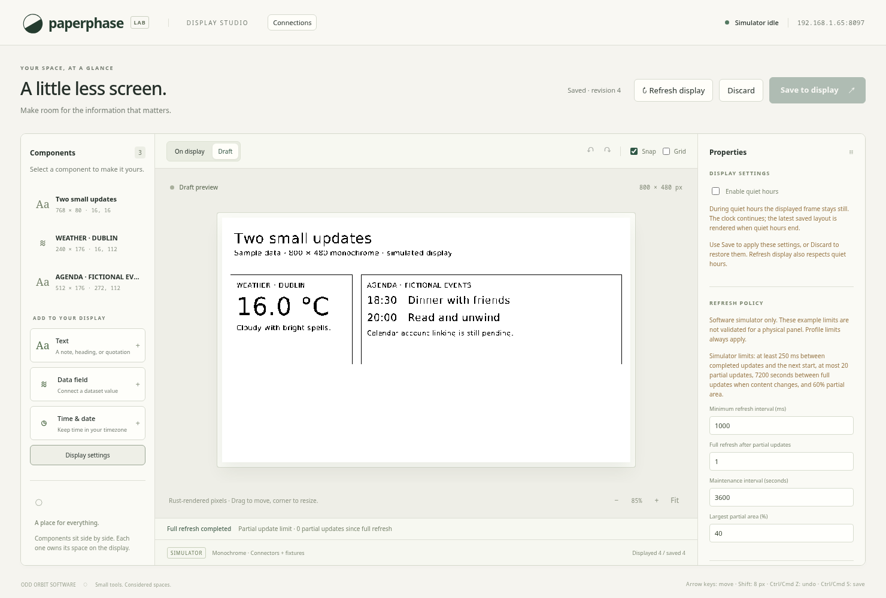
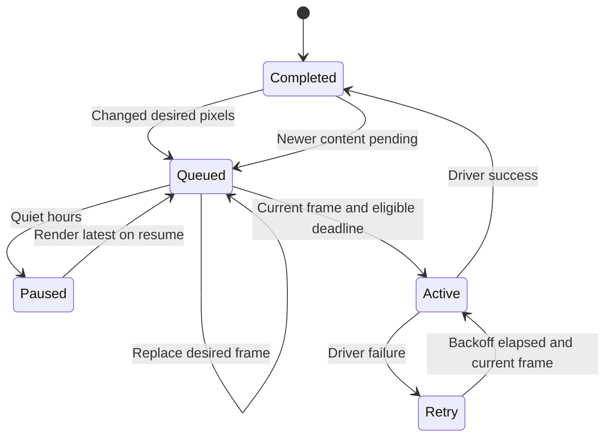

# Simulated display refresh controller

The service now separates desired pixels, queued work, the one active display
operation, and the last completed frame. A pure controller chooses a partial or
full refresh; a single worker executes simulated operations. Fetching still
follows its own schedule and continues during quiet hours.

The screenshot is from the running desktop simulator. All profile values below
are synthetic test limits. They describe no Waveshare panel or physical timing.

## Records and ownership

| Record | Contents |
| --- | --- |
| `RefreshHint` | Per-component request: `automatic`, `partial`, or `full` |
| `RefreshPolicy` | Saved minimum interval, partial-count limit, full-refresh age, and maximum partial area |
| `Profile` | Host-owned capabilities, alignment and hard limits; currently `software-simulator` |
| `Plan` | Mode, reason, aligned operation rectangle, and original changed-pixel bounds |
| `Operation` | Plan plus the exact layout revision being sent |
| `Controller` | Known-baseline flag, successful partial count, monotonic full/completion times, failure/backoff state, active and last completed operations |
| `PreparedFrame` | Rendered pixels/PNG, layout, revision, data generation, render time, next content deadline, and quiet state |
| `Workspace` | Latest saved layout, optional desired frame, completed pixels/layout/PNG, pending state, and worker ownership |

Old workspaces acquire the default policy; components acquire `automatic` hints.
The JSON schema and experimental application version stay at 1 and `0.1.0`.
Validation rejects unsupported hint values and policy values outside bounded
ranges. Profile limits cannot be disabled through a component hint or user policy.

The simulator seeds its initial frame as a known completed image at startup.
Controller history is in memory and resets on restart. This is not physical
retained-frame recovery: a future hardware driver must establish its baseline
with a successful full refresh before permitting partial updates.

## Choosing an operation

Compare the desired packed monochrome frame with the completed frame using XOR.
The union of actual changed pixels covers new ink, erased ink, old component
positions, and removed elements. One bounding rectangle deliberately combines
separate changed regions; sending multiple partial windows is future driver work.

1. Skip unchanged pixels when the baseline is known. A metadata-only save can
   acknowledge its new revision without an operation or maintenance flash.
2. Round the dirty rectangle outward to profile X/Y alignment, clamping at the
   display edges. The synthetic profile uses eight-pixel X and one-pixel Y
   alignment, including partial windows ending at an odd-width display edge.
3. Select a full refresh, in priority order, for an unknown baseline, missing
   partial capability, a full-request component intersecting the dirty bounds,
   an exhausted partial count, elapsed full-refresh age, or an oversized aligned
   region. Otherwise select partial.
4. A full operation covers the complete display. A partial request is a
   preference and cannot override any full-refresh condition.

Full requests consider desired components and the former rectangles of moved
or removed full-request components. Changing a request on a component that stays
in place takes effect immediately. Intersection with the union dirty bounds is conservative: a full-request component between
two changed areas may also promote the operation.

| Policy | Default | Synthetic profile hard limit |
| --- | --- | --- |
| Minimum interval after completion | 250 ms | At least 250 ms |
| Successful partial updates before next full | 10 | At most 20 |
| Full-refresh age when content next changes | 3600 seconds | At most 7200 seconds |
| Largest aligned partial region | 40% | At most 60% |

User policy can be stricter. Count/age thresholds trigger on the next changed
frame, not on an idle timer. A full refresh resets the count and age only after
success. Failed operations do not increment successful counters.

## Queuing, timing, and quiet hours

A 180 ms batch window collects rapid saves. Pending frames can be replaced with
newer desired content. Before starting, the worker checks the saved revision,
data generation, time/freshness deadline, backward wall-clock movement, and quiet
hours. Obsolete frames are discarded; the scheduler renders current content.

The worker then waits for the stricter user/profile minimum interval and any
failure backoff. These deadlines use monotonic time, so a wall-clock adjustment
cannot bypass them. A notification wakes a waiting worker when settings or
desired content change; reducing an interval takes effect immediately.

Once active, an operation owns its frame until completion; another save or fetch
cannot cancel it or start a second operation. The synthetic driver takes 180 ms.
On success the exact sent frame becomes the completed PNG/revision, even when a
newer save or a time boundary arrived during execution. Newer content stays
pending and is processed next. Thus an older revision can briefly be displayed
without being reported as the latest saved revision.

Quiet hours prevent new operations from starting. An already active operation
finishes and records its real simulated outcome, then pauses. On resume the
service renders current data rather than replaying intermediate frames.

## Failure and status

Failure retains the last completed image/revision and marks the display baseline
unknown. Retry delays are 1, 2, 4, 8, 16, then 32 seconds, capped at 32. Manual
Refresh display enters the same controller and cannot bypass backoff or interval
limits. Recovery requires a full refresh even if desired pixels equal the old
completed image. Success clears the error and failure count.

Fault injection is available only inside Rust tests; the normal simulator
driver succeeds. A physical driver still needs timeout/disconnection handling
and a supported profile. This slice claims no SPI/GPIO access or panel health
validation.

`GET /api/state` includes the profile, active operation, last completed operation,
partial count, baseline flag, failures, and remaining eligibility delay. The UI
shows mode and a readable reason below the canvas, with region/revision details
in its tooltip. Display settings edit the saved policy; component properties
edit the request. Browser previews never enqueue display operations.

## Verification

The complete Rust checks passed with 89 tests on x86-64 Linux; TypeScript,
frontend build, and all 11 Chromium flows passed. The diagrams render in Mermaid
and the actual UI screenshot was reviewed. Results are recorded in
[the changelog](../../changelog.md). Pure
controller tests cover alignment, removed/moved pixels, all full-refresh
conditions, profile caps, unchanged frames, and monotonic spacing/backoff.
Scheduler tests exercise batching, active-operation serialization, both sides of
the quiet-hours boundary, failure recovery, stale prepared frames, and waking a
worker after an interval change. Browser coverage exercises saved requests and
policy settings, host promotion from partial to full, unchanged manual refresh,
and persistence alongside the existing editing flows. An additional browser
metadata fixture checks failure backoff, active full recovery, and newer queued
layout status; Rust tests exercise the actual injected driver failure. Pi and
physical-panel validation remain pending.

See [operator instructions](../usage/refresh-controller.md).
