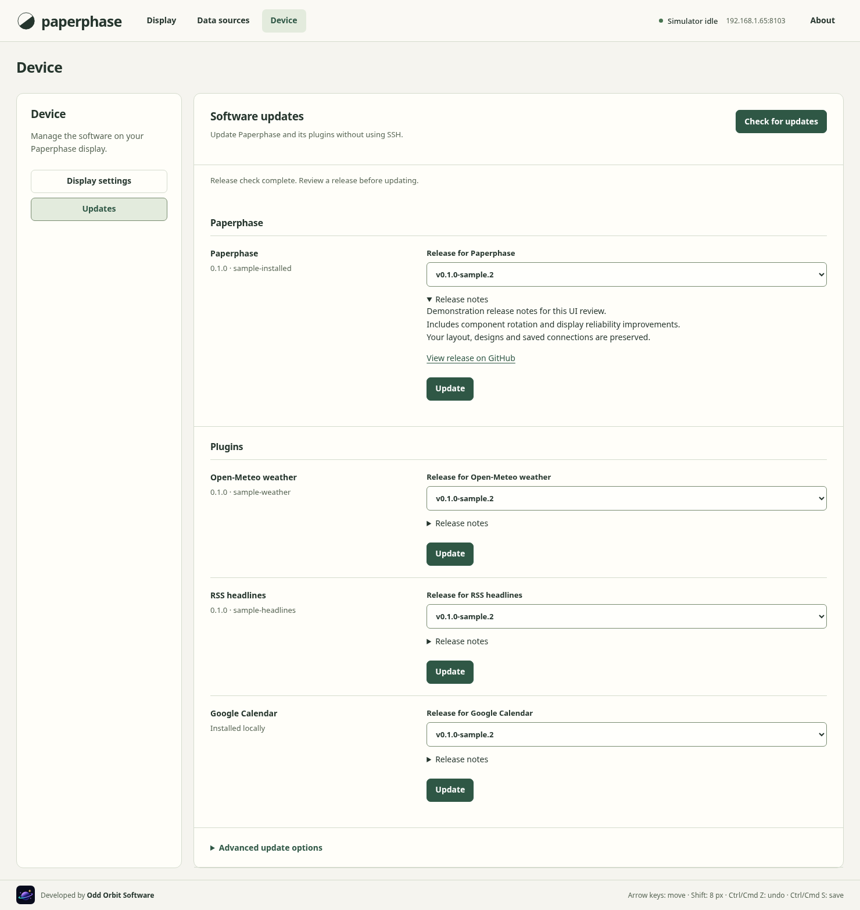
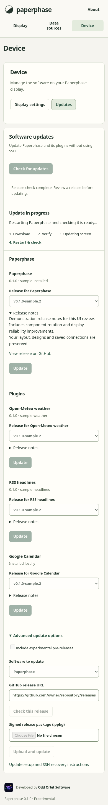

# Release updates and independent recovery

Status: implemented on `release-updates`; validation is recorded below as it is
completed. No GitHub release has been published by this implementation. The
foundation application/package version remains `0.1.0`.

## Ownership and private installation records

`paperphase-update-agent` supervises a normal `paperphase serve` child. Its
bootstrap executable and operator configuration stay outside writable release
slots. The LAN app prepares requests; the supervisor owns backup, activation,
restart, health approval and rollback. No LAN route can select an arbitrary
executable, shell command, filesystem destination or service-control action.

`Installation` records distinct absolute managed/data folders, optional working
directory, original serve arguments, loopback health URL, read-only status port
and registered targets. Each target identifies a repository, trusted Ed25519
public keys, application platform or plugin ABI/identity, and an operator's local
baseline. `Active` selects immutable verified release directories per target.
Plugin slots override only Wasm/icon paths; host-owned source URLs, auth-setting
bindings, reference archives and budgets retain their original registrations.
This first flow updates already registered plugins; new plugin contracts and
permission onboarding remain separate platform work.

A private `Job` records target, phase, signed manifest, previous `Active`, backup
completion and the acknowledged Updating frame hash. Each job has a random
128-bit ID and a private directory. Atomic file replacement commits records;
files are synced before rename. A post-commit directory-sync failure is logged
without pretending the old record remains current. Single-agent/workspace locks
and one active transaction prevent concurrent activations. All JSON records have
read/write limits; no private state values appear in public progress.

```mermaid
sequenceDiagram
  participant UI as Owner browser
  participant App as Running app
  participant Display as Serialized display worker
  participant Agent as Independent supervisor
  UI->>App: Check and explicitly select update
  App->>App: Download and verify signed package
  App->>Display: Queue full Updating frame
  Display-->>App: Successful presentation acknowledgement
  App->>Agent: Durable ready transaction + frame hash
  Agent->>App: Graceful stop
  Agent->>Agent: Back up private state; select verified slot
  Agent->>App: Launch child with output held
  Agent->>App: Check initialized health + child/transaction identity
  alt Healthy
    Agent-->>App: Approve normal output
    App->>Display: Restore according to saved display/quiet-hours policy
  else Failed startup
    Agent->>Agent: Restore previous release and compatible data
    Agent->>App: Launch previous child; health-check rollback
  end
```

## Package verification

A `.ppkg` begins with `PAPERPHASE-PKG1`, a bounded JSON-envelope length and an
Ed25519-signed manifest encoded without reserialization. One gzip stream then
contains the exact ordered regular-file payloads. The manifest binds repository,
release tag, package version, build, updater protocol 1, state schema 1, target,
every filename, byte count and SHA-256. Filenames come from a small fixed set:
`paperphase` for native apps; `plugin.wasm` and named icon assets for plugins;
optional bundled `NOTICE.txt`. Paths, links, caches, hooks and undeclared trailing
bytes are rejected. Extraction uses new private directories and bounded chunks.

Limits are 64 MiB compressed, 128 MiB expanded, 64 KiB envelope, and 8 MiB for a
plugin payload; the existing runtime's lower 2 MiB module limit also applies.
A native package must match this host's 64-bit Linux ELF architecture and answer
a bounded `update-capabilities` probe without opening private state/network/GPIO.
The probe checks platform, updater/state protocol and plugin ABI, including
loader compatibility. Portable plugins compile with the normal runtime and
validate required exports/import types without executing a Wasm start function.
Icon packages use the existing bounded loader.

Trusted publisher private keys never enter images or release packages. Only
public keys are included in `deploy/publisher-keys.json` and installation config.
The signing tool uses explicit private-key paths. Generated local key material
lives in ignored `.paperphase/release-signing/`, mode 0600 in a private directory.
Package construction copies only declared payloads/notices and refuses existing
release-asset destinations.

GitHub discovery uses the configured repository, excludes drafts and defaults
to normal releases. Experimental releases require explicit opt-in. Checks share
one list request per repository across bundled plugins. A supplied release page
must belong to the configured repository. Downloads build canonical release
asset URLs, follow only bounded HTTPS redirects among supported GitHub hosts,
and verify declared length and any GitHub-provided SHA-256 in addition to the
publisher signature. Connector authentication, cookies and environment proxies
are never attached. The API contract is documented by GitHub's
[release endpoints](https://docs.github.com/en/rest/releases/releases) and
[asset endpoints](https://docs.github.com/en/rest/releases/assets).

## Maintenance, activation and recovery

Preparing a package does not change the saved layout or completed frame. A
verified package requests a full Updating presentation through the existing
worker. It respects physical cooldown/retry limits, serializes after an in-flight
operation, and retries failure as full recovery. Explicit update maintenance may
show its notice during quiet hours; normal output afterward follows saved quiet
hours. Data/clock/rotation frames cannot overwrite the notice. Save/config writes
are locked during maintenance; the layout draft must be saved/discarded before
an owner can start an update. Automatic provider/reference fetching pauses during
maintenance and startup probation, retaining persisted cooldowns across restart.

The supervisor independently re-verifies the staged package, stops the child,
backs up regular private files (1 GiB bound) and records backup completion before
selecting the new slot. It rejects unsupported schema migrations. A child starts
with normal output held until health approval. Health requires initialized
runtime/editor, expected launch ID and process ID, and a short stable ready
period within 180 seconds. Process start-time records and a parent watcher let a
new supervisor safely reap an orphan after interruption without PID-reuse kills.

Before successful health approval, failed startup restores previous slots and a
complete compatible private-data backup. Partial backups never replace data.
Restore stages a new data directory, retains failed-version data privately,
then replaces the active data folder. Physical journals retain a conservative
cooldown before recovery output. Interrupted phases recover from durable records
on supervisor restart. Failed rollback reports `recovery_required`, retaining
backup/previous records for explicit SSH recovery while the service is stopped.
Completed jobs/backups/slots are retained; automatic storage retention remains
future foundation work.

The read-only supervisor endpoint survives main-app replacement. It exposes only
public transaction progress and limits browser CORS reads to the same hostname
and configured app port. The editor CSP permits that specific status origin.
The browser reconnects to the normal app afterward. Bundled setup/recovery help
is served by both processes, so recovery guidance is available during downtime.

## Owner interface

Device → Updates preserves DESIGN.md's paper/green system. Owners check,
review versions/notes, then confirm one explicit update/restart. Experimental
channels, a specific release URL and signed package upload sit under Advanced.
Unsaved layout changes remain available and prevent installation. Stable focus
identities distinguish targets; accepted updates reveal/focus progress once,
while polling preserves position. The current Device subsection is visibly
selected. Terminal states distinguish success, unchanged installation, successful
rollback and required SSH recovery. The helper reports progress independently
of the app's temporary disappearance.





Additional captures: [successful rollback](images/release-updates-rollback.png)
and [bundled operator help](images/release-updates-help.png).

## Validation ledger

- Signed-package tests cover roundtrip identity, untrusted signatures, tampering,
  malformed paths, duplicate files, expansion bounds and trailing data.
- Process integration has demonstrated core activation, startup-failure rollback,
  interrupted-supervisor recovery and rejection before display changes. Installed
  plugin execution and retained grants/cache/cooldowns also passed.
- `sh scripts/check.sh` passed 216 Rust and 13 Python tests.
- Browser flows cover explicit checks/confirmation, experimental defaults,
  unsaved drafts, independent progress/recovery, manual-install setup and focus/
  file persistence/reveal-on-start. All 50 distinct browser flows passed across
  the existing suite and updater regression runs.
- Fresh UX review requested keyboard identity, reveal-on-start progress,
  subsection selection and completed documentation. All four fixes were scored
  resolved; the finish reviewer returned `ship` for that fix batch, including
  the bundled help at desktop and mobile widths.
- ARM64 release compilation passed. On the Zero 2 W with the V2/Rev2.3 panel,
  real browser uploads activated a signed synthetic plugin and native app under
  the managed systemd unit. Both jobs recorded Updating acknowledgement and a
  complete backup before restart, then reached healthy. The plugin's completed
  physical frame returned with the changed sample value 24 (previously 18).
- A signed native fixture passed capability preflight but deliberately exited
  during startup. The Pi supervisor restored both previous active slots and
  compatible data under the actual namespace permissions. The browser displayed
  Previous version restored; same-host supervisor reads returned 200. Panel
  operations retained the 180-second floor. Synthetic packages used the explicit
  `validation/paperphase` identity and were not public GitHub releases.
- The regular installation was backed up, its owner layout hash stayed unchanged,
  and the managed regular unit was started with all nine plugin registrations.
  The recovery full refresh acknowledged owner revision 5; output returned idle
  without error, and both regular services remained active with the main service
  enabled. The owner has not yet confirmed optical readability/retention of this
  test's Updating message.
- The regular Pi browser performed a real GitHub check for all ten registered
  targets with HTTP 200 and no per-target errors. Independent bundled help also
  returned 200. Discovery currently finds no releases. A real signed release must
  be published with owner authorization before download/activation from that
  release can be claimed tested. Desktop mocks/uploaded packages do not prove it.
- Real Google-account longevity and longer optical panel qualification remain
  separately recorded foundation work.

Owner/operator instructions are in [release-updates usage](../usage/release-updates.md).
