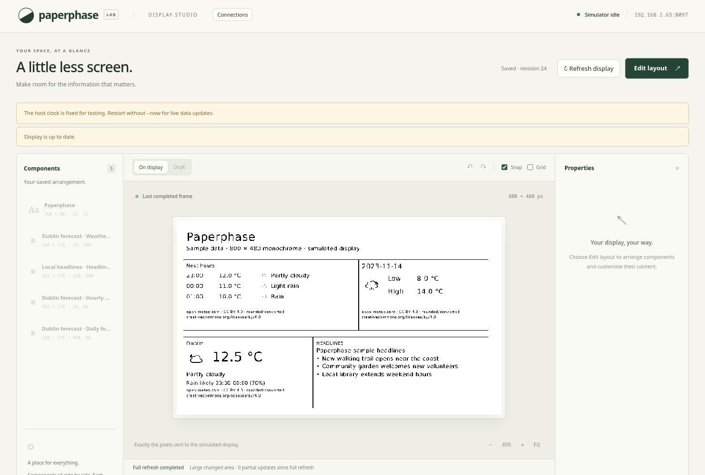
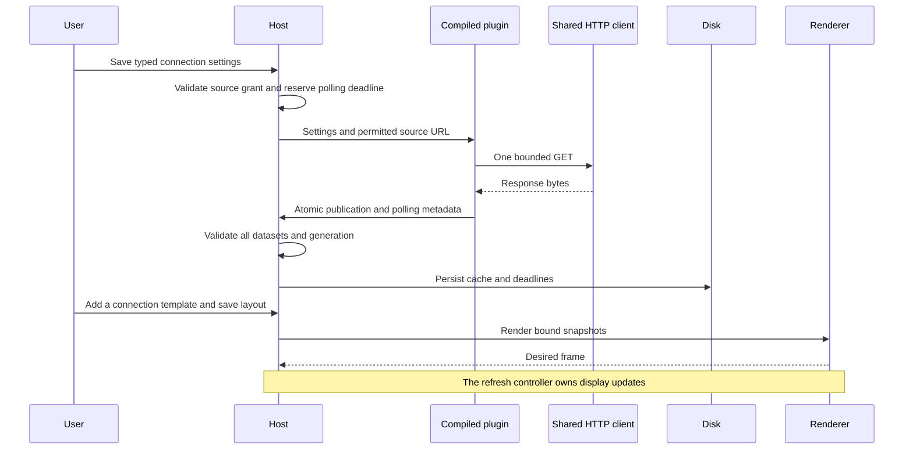
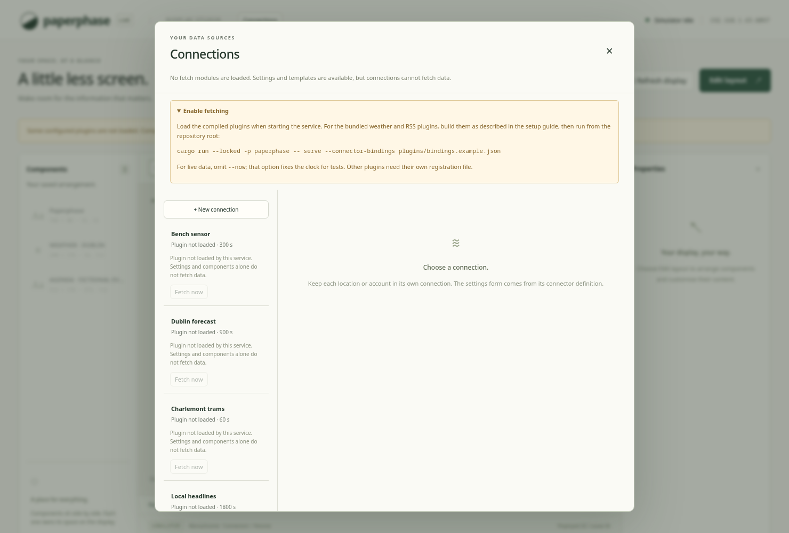

# Weather forecasts and feed headlines

Two Rust plugins now run through the shared Wasm host: Open-Meteo weather and
RSS/Atom headlines. Their metadata supplies generated settings and reusable
component templates. Installation still uses a local registration file; UI
package installation and the public plugin contract remain later work.

This actual Chromium screenshot uses deterministic local fixtures, including
fictional headlines and a clock pinned to November 2023. It is not a photograph
of the panel or a live forecast. The independent live-weather check is recorded
below.

## Host additions

| Structure | Responsibility |
| --- | --- |
| `SettingInput::Number` | Finite decimal values with inclusive bounds; used for coordinates |
| `SettingInput::Url` | Absolute HTTP(S), no credentials/fragments, at most 2048 bytes |
| `ComponentTemplate` | Stable ID, name, and ordinary validated `Component` |
| `Component.label` | Optional editable name, separate from stable identity and displayed content |
| `Publication` | Primary dataset, optional observation/polling metadata, and up to seven additional datasets |
| `ConnectionData.additional_snapshots` | Additional cached datasets committed with the primary result |
| Registration `source_setting` | Explicit host permission to grant the origin of a required URL setting |
| Registration `origin_interval_secs` | Shared-origin spacing, separate from each connection's polling interval |

Templates use the connection placeholder `template` in field bindings. The
browser clones the component, generates a fresh component ID, substitutes the
chosen connection ID, and names it from the connection/template labels. It scans
eight-pixel positions for free space; failure leaves the layout intact. Text,
font sizes, positions, and bindings remain editable with the existing builder.
Template geometry and bindings are validated before metadata reaches the UI.

The optional `publish_with_metadata` host call accepts one JSON `Publication`.
IDs must be unique across its datasets; the combined publication remains bounded
by 64 KiB. The primary `observed_at` contributes to freshness; additional
forecast datasets use successful fetch time unless their IDs have explicit
entries in `additional_observed_at` (used by Luas for arrival observations).
`min_poll_secs` is a lower-bound hint of 1–604800 seconds and cannot shorten connection/provider cooldowns.

Legacy `publish` still accepts one plain dataset. Both calls share a single
publication slot, and a trap or nonzero guest status discards the entire result.
The host updates all cached snapshots atomically. Failure or reconfiguration
keeps the previous datasets and marks each stale. Successful empty results
replace old content. Snapshot/catalog/cache byte limits still apply to the
complete merged data, including fixtures.

A URL-setting registration grants one exact scheme/host/effective port per
invocation, using the saved settings at claim time. The grant is not expanded
by links or XML content. The claim retains its original origin, so late HTTP
429/503 hints still apply to that origin after a configuration change. Origins
share their configured spacing and provider backoff. Expired deadlines are
removed before reserving another request; active deadlines survive restarts.

## Weather

`plugins/weather` requests current conditions, hourly forecasts, and daily
forecasts in one Open-Meteo GET. Coordinates and a display label are independent;
the label is not geocoded. The API selects the location's timezone. Forecast
labels use the shared compiled timezone database and explicit Unix timestamps,
not the browser timezone or a fixed UTC offset.

| Dataset | Contents |
| --- | --- |
| `current-weather` | Celsius temperature/feels-like, humidity, wind in km/h, condition code, day flag, display temperatures, condition text/symbol, rain summary, observation metadata and attribution |
| `hourly` | Up to 48 upcoming hourly endpoints with local labels, temperature, combined rain/showers amount, precipitation probability, condition code/text |
| `daily` | Up to seven local dates with minimum/maximum temperatures, precipitation total/probability, and condition code/text |

Raw measurements keep their declared units. Choosing Fahrenheit changes the
`display-*` temperature strings and leaves numeric Celsius fields suitable for
consistent bindings. Null measurements remain null. Unknown weather codes use
an unavailable description and question-mark symbol. Schema, unit, time ordering,
timezone, and array-length errors fail the invocation and retain last good data.

The rain summary finds the first upcoming hourly window with at least 0.1 mm of
rain plus showers and the configured probability threshold (50% by default).
Open-Meteo's precipitation fields describe the preceding hour at each endpoint;
the summary therefore shows that window, or “this hour” for its remaining
portion. A future date is included where needed. Missing earlier rain/probability
data produces “Rain timing unavailable”; it never becomes a claim of dry weather.
This is a forecast window, not a precise rain-onset prediction. Hourly data
requests include one extra endpoint so filtering the elapsed/current endpoint
can still supply the configured number of upcoming periods.

Weather datasets publish semantic `icon-key` values, and new templates use static
monochrome Meteocons stored with the plugin. Current/hourly clear conditions use
the provider day/night flag. Legacy font-symbol fields remain available for
existing layouts. See [plugin-owned icons](plugin-icons.md) for assets, mappings,
validation and editor behaviour. Attribution and conversion/rounding notices
remain in each weather template.

The free endpoint is restricted to non-commercial use and its data require
attribution under CC BY 4.0. Polling defaults to 900 seconds, with a 600-second
connection floor; the example live registration spaces weather-origin requests
by 30 seconds. This leaves headroom under the published quotas for ordinary
single-host use, but does not account for other applications sharing the IP.
Provider terms and data licensing are distinct from Paperphase's code licence.
These choices were checked on 2026-11-11 against the
[API documentation](https://open-meteo.com/en/docs),
[terms](https://open-meteo.com/en/terms), and
[data licence](https://open-meteo.com/en/licence).

## RSS and Atom

`plugins/rss` reads public UTF-8 RSS 2.0 and Atom feeds, preserving publisher
order. A streaming XML reader tracks namespace, depth, XML base URL, entry, and
the field currently being captured. It supports text, CDATA, standard XML
references, Atom HTML/XHTML titles, relative links, and alternate Atom links.
HTML title markup becomes plain text; article bodies and images are not fetched.

The parser rejects DTDs, unsupported encodings, malformed XML, wrong roots,
unknown entities, excessive nesting, and exhausted budgets. Bounds are 64 KiB
response bytes, 32 levels, 20000 events, 512 examined entries, 16 KiB per captured
field, and at most five retained titled entries. UTF-8-safe truncation bounds
individual titles to 512 bytes. Parsing continues after the retained-item limit
so malformed trailing XML cannot replace good cached content.

Entries are deduplicated by ID, then link, then title. Safe article links are
resolved but never requested. The `headlines` dataset has one row per retained
entry, with `title`, `link`, `published`, `feed-title`, `source`, and a repeated
aggregate `headlines` string. The aggregate contains the feed title and selected
headlines, letting the first template use a scalar binding while later list
elements can use the individual rows. Missing publication dates remain null;
dates do not control item ordering or snapshot freshness.

RSS channel TTL raises the next polling deadline; it cannot lower the
900-second connection floor. A TTL above seven days is rejected rather than
silently fetched earlier. Valid empty feeds publish zero rows and render the
normal empty-result state. A feed with entries but no usable titles fails and
keeps previous content. Authentication, redirects, RSS 1.0/RDF, non-UTF-8 feeds,
HTTP conditional requests, skip-hour/day rules, and automatic headline rotation
are not implemented. Publisher access/attribution requirements still apply.
Format references: [RSS 2.0](https://www.rssboard.org/rss-specification) and
[Atom](https://www.rfc-editor.org/rfc/rfc4287).

## Startup diagnostics

Templates remain available without an executable module, so an offline layout
can be prepared. That state is now explicit: unloaded connections keep a
visible disabled Fetch button and setup explanation, and template labels show
that their plugin is not loaded. Connections offers the registration command.
The workspace API exposes `clock_fixed`; configured live integrations show a
warning when `--now` pins polling/freshness time. Neither warning changes the
saved layout, grants new network access, or bypasses a cooldown.

## Validation and next work

The full Rust check script and browser suite exercise the actual compiled guests,
not substituted host implementations. Coverage includes decimal/URL validation,
template rebinding, multiple publications rejected, metadata bounds, all-or-none
results, forecast arrays/local times/nulls, feed parsing/security budgets,
origin grants, durable TTL, empty results, stale caches, and preview/frame equality.
The full script passed 108 Rust tests, formatting, host/guest Clippy and three
guest builds on x86-64 Linux. TypeScript/frontend builds and all 13 Chromium
flows passed. The 48-hour compiled weather fixture remained within the existing
fuel budget. Mermaid diagrams rendered and actual screenshots were reviewed.
A live Open-Meteo request through the guest returned fresh current conditions,
24 upcoming hourly periods and three daily forecasts on 2026-11-11. RSS tests
use local RSS/Atom fixtures; publisher-specific live validation remains separate.
See [the changelog](../../changelog.md).

The user prioritised [Luas](luas.md) next. Air quality remains planned as a
separate plugin from weather so failures and polling
can be independent. Historical storage, chart/list builder nodes, package
installation, and the AI authoring skill remain pending. Zero 2 W memory/runtime
measurements, Google account setup, and physical display behaviour still need
their own validation.

See [setup and operation](../usage/weather-and-rss.md).
