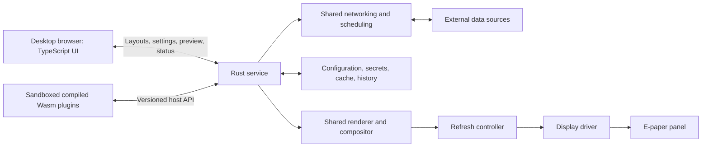

# Architecture plan

Status: agreed architectural boundaries and outstanding design work. No
hardware benchmark has been completed. The first
[plugin validation harness](../design/plugin-foundation.md) is implemented;
detailed contracts below still identify outstanding work rather than fixing the
final API or runtime choice.

The [shared data model and monochrome renderer](../design/data-and-rendering.md)
now provide typed bindings, non-overlapping layout validation, freshness status,
and PNG/PBM simulator output. The desktop editor and service are still pending.

See [requirements.md](requirements.md) for product scope and hardware uncertainty,
and [delivery-plan.md](delivery-plan.md) for the agreed implementation sequence.

## Runtime boundaries

Run one independent Rust service per Pi on 64-bit Raspberry Pi OS Lite. It
starts at boot and serves the UI on the LAN without an application login.
The browser executes the frontend; the Pi does not need a Node.js server or
browser engine.

The host owns shared services. Plugins request networking, scheduling, storage,
and rendering through its API rather than bundling independent clients. The
plugin API must not expose arbitrary Rust dependency types across the boundary.

Only the host's display subsystem accesses SPI/GPIO. Connector plugins express
update needs; the host selects a supported refresh operation.

## Plugin execution and installation

Distribute compiled WebAssembly packages. Validate the Wasm and compile it to
native code for execution; do not use an interpreter backend. The user has
accepted this direction subject to measurements on the Zero 2 W.

Wasmtime is the first runtime candidate to evaluate, not a final dependency.
Its native compiler supports AArch64. Runtime evaluation must measure resident
memory as well as installation peak memory, compilation time, execution latency,
and recovery from stuck plugins. No measured performance is claimed.

Plugins receive explicit host capabilities. Define resource limits for guest
memory, CPU execution, requests, response sizes, and storage. Host operations
need deadlines and cancellation independently of guest instruction limits.
Do not grant general filesystem, socket, or hardware access by default.

Accept packages uploaded in the UI or downloaded from a GitHub release URL.
Both sources use the same validation and activation path. Restarting the service
after installation is acceptable. Package compatibility, requested access,
activation failure, and rollback behaviour need a detailed installation contract.

For Wasmtime, never load native compiled caches received from an arbitrary
publisher. Generate caches from validated Wasm through the host's own compiler.
Runtime/compiler upgrades must invalidate incompatible caches. This is a
requirement of the chosen trust boundary, not a claim that compilation alone
establishes publisher authenticity.

## Connectors, datasets, and components

Keep three concepts separate:

| Concept | Purpose | Example |
| --- | --- | --- |
| Connection | A configured connector/account and its fetch schedule | A weather location or one Google account |
| Dataset | Data available for binding to components | Forecast rows, calendar events, headlines |
| Component instance | A placed, customised presentation | Agenda, arrival list, weather summary |

One connection can serve several components. Changing appearance should not
require another API fetch. Credentials, request deduplication, and caches must
preserve connection/account boundaries.

Components can use any compatible dataset, regardless of which plugin supplied
their template. The data contract therefore needs field types, units, collection
structure, and freshness metadata. Specify stable field identity and schema
versioning before committing to a package ABI.

Separate plugin connection settings from component presentation settings.
Plugins provide setting definitions for generated forms, including validation,
help text, defaults, adjustable intervals, and secret fields. Account linking
needs an action flow in addition to ordinary form fields.

The exact dataset schema, binding operations, error representation, OAuth host
services, and template format are the next contract-design tasks.

The built-in time and date component uses the host system clock and the shared
renderer, without a network connector. Schedule renders at the next visible
time/date boundary in the configured timezone rather than incrementing a stored
time value. Recalculate boundaries after clock or timezone changes, including
daylight-saving transitions. Default to minute precision for time. The displayed
preview continues to show the last completed frame rather than independently
ticking in the browser. Normal refresh and quiet-hours rules still apply.

## Builder and preview

The desktop editor prioritises the display canvas, with host IP addresses and
display status always easy to find. It supports non-overlapping placement,
resizing, optional snapping, numeric geometry, keyboard movement, undo/redo,
and Save/Discard.

Plugin templates provide starting designs. A visual builder exposes text,
icons, lists, charts, and data bindings within a component. The initial building
blocks and detailed builder interactions still need specification.

Highlight invalid placements while dragging. On an invalid drop, restore the
last valid position without moving neighbours. Resizing reflows content using
explicit font sizes and configurable wrapping/truncation; it does not scale the
entire component proportionally.

Validate geometry in native display pixels, independently of browser zoom.
For each proposed rectangle, check positive dimensions, component minimum size,
panel bounds, and intersection with the other component rectangles. Touching
edges are allowed; a positive-area intersection is a collision. Repeat layout
validation on the server when saving so UI feedback and persisted state obey
the same rules.

The shared host renderer produces component pixels for the preview and physical
display. Browser selection and drag handles are editing overlays. The preview
must account for the selected panel's pixel format; it is not a photograph or
physical readback of the panel.

The UI must distinguish:

| State | Meaning |
| --- | --- |
| Displayed | Last known frame from a completed display operation |
| Draft | Unsaved layout/presentation changes |
| Pending | Saved changes awaiting a successful physical update |

A failed or interrupted display operation makes physical content uncertain.
Do not present a stored framebuffer as verified physical content after such a
failure. Precise recovery behaviour belongs in the display-driver contract.

## Update ownership

Data fetching, component rendering, and physical refresh have separate schedules.
Transport should target 30–60-second visible updates when supported; other
connectors can fetch much less frequently.

Manual "Fetch now" and "Refresh display now" actions enter their respective
schedulers. Neither bypasses provider limits or the panel refresh policy.
Quiet hours still freeze the physical display while allowing data fetching.

The host compares desired content with its completed frame, identifies changes,
and chooses partial or full refresh according to panel capabilities and health
policy. Moving or removing a component also invalidates its former rectangle.
Non-overlap simplifies composition, but driver alignment and partial-refresh
baseline requirements still apply.

Serialize physical updates. Multiple pending changes can be combined; the UI
must not report a desired frame as displayed before the operation completes.
Specify sleep/resume handling, minimum refresh intervals, maintenance thresholds,
and interrupted-update recovery for each validated panel profile.

During quiet hours, continue fetching but freeze the physical display. On exit,
use the newest data rather than replaying intermediate frames. The detailed
policy must reconcile quiet periods with panel maintenance before hardware
support is declared complete.

## Failure, calendar aggregation, and history

Retain last good component content and show an in-component stale indicator
when a data source fails. A successful empty result must be distinct from an
error. Define freshness using fetch and source observation times where available.

One agenda combines selected calendars from multiple accounts with source
labels. Specify sorting, timezone/all-day handling, recurrence, duplicate-event
behaviour, and partial-source failure before implementing the aggregator.
Privacy settings can hide descriptions, locations, or titles while retaining
availability. Use the same filtered presentation in preview and display output.

Provide bounded historical storage for future graphs. Select retention, write
batching, and aggregation rules when specifying storage. No air-quality connector
is currently in scope.

## Work required before implementation commitments

| Area | Evidence or decision needed |
| --- | --- |
| Plugin runtime | Zero 2 W measurements and demonstrated resource/cancellation limits |
| Plugin API | Package manifest, settings/dataset/template schemas, capability model, version compatibility |
| Google Calendar | Supported account-linking flow from another LAN machine and token renewal |
| Luas | Working endpoint, stop/direction identifiers, usage limits, attribution |
| Display | Exact revision/resolution and full/partial refresh plus recovery tests |
| Desktop UX | Canvas/builder interactions, collision behaviour, resize and overflow rules |
| Persistence | Store choice, secret handling, bounded history, migrations, backup behaviour |

## References

- [Wasmtime platform support](https://docs.wasmtime.dev/stability-platform-support.html)
- [Wasmtime precompilation and cache trust](https://docs.wasmtime.dev/examples-pre-compiling-wasm.html)
- [Wasmtime sandbox boundaries](https://docs.wasmtime.dev/security.html)
- Integration and hardware references are in [requirements.md](requirements.md#sources-and-validation-notes).
