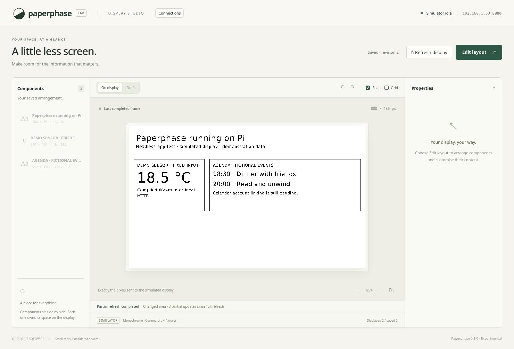

# Run the foundation harness

This is a developer CLI for validating compiled plugins. The same executable
also serves the [browser editor](desktop-editor.md) and a simulated display;
physical display support remains separate work. See the
[implementation design](../design/plugin-foundation.md).

## Build and check

Use Rust 1.96 or newer with Cargo, Rustfmt, and Clippy. Install the guest target:

```sh
rustup target add wasm32-unknown-unknown
```

Run the complete check from the repository root:

```sh
sh scripts/check.sh
```

This checks formatting and lints, builds the Rust example into portable Wasm,
then runs all tests including the real compiled guest. Tests create loopback
HTTP servers; the environment must permit local sockets. No provider credentials
or external API access are needed for tests.

`cargo test --workspace` alone runs the other tests and reports the compiled
guest tests as ignored. The full script supplies the artifact and enables them.

## Deterministic demo

```sh
cargo build --locked --release -p paperphase-temperature-example --target wasm32-unknown-unknown
cargo build --locked --release -p paperphase
./target/release/paperphase demo \
  --plugin target/wasm32-unknown-unknown/release/paperphase_temperature_example.wasm \
  --iterations 10
```

The command creates a temporary loopback API, runs the plugin against it, prints
a JSON report, and shuts the API down. The sample observation is always 18.5 °C.
The plugin fetches the observation through the host and converts it into a
typed dataset. No external weather service is contacted.

The report separates runtime setup, native module compilation, and invocation
times. It includes architecture, build profile, fuel consumption, HTTP request
count, and guest memory size. Linux RSS/high-water readings cover the whole
process and are not plugin-only measurements. The example server's scheduling
also contributes to invocation latency.

To run against another explicitly selected source:

```sh
./target/release/paperphase run \
  --plugin target/wasm32-unknown-unknown/release/paperphase_temperature_example.wasm \
  --source-url http://127.0.0.1:8080/observations
```

This example plugin expects an object with a numeric `temperature_c` field.
The host grants only the configured URL's origin and rejects redirects. Provider
polling and rate-limit scheduling are not implemented yet; use the deterministic
demo for repeated benchmarking.

## Zero 2 W validation

On 64-bit Raspberry Pi OS Lite, use a native AArch64 host build. A portable guest
Wasm artifact can be built on another machine and copied to the Pi; the host
then compiles it to the Pi's native instructions during preparation.

Keep host compilation separate from application runtime measurements. Building
the full Rust toolchain/dependency graph on a 512 MB Pi may require more memory
than running the resulting application. Build on a suitable AArch64 machine or
use a properly configured cross-compilation toolchain when necessary.

Run a release demo on the Pi and save the report outside the repository's
tracked files. Record OS, architecture, available memory, host/guest binary
sizes, setup/compilation times, RSS, and repeated invocation measurements. Use
external process monitoring as well to examine transient compilation peaks.
The CLI report does not measure a production install path or a long-running
service. Measure the editor process separately from the one-shot harness.

### First headless Pi results — 2026-11-14

The current working tree was tested on a Raspberry Pi Zero 2 W Rev 1.0 with no
display attached: 64-bit Raspberry Pi OS Lite / Debian 13.7 (Trixie), kernel
`6.18.50+rpt-rpi-v8`, glibc 2.41, and 415 MiB reported RAM. Rust 1.96.0 and
Zig 0.15.2 built the ARM64 release executable on the desktop, targeting
`aarch64-unknown-linux-gnu` and glibc 2.41. No Rust toolchain was installed on the
Pi. The executable was 14,815,808 bytes, with the frontend embedded.

All 31 runtime boundary tests passed natively on the Pi with `--include-ignored
--test-threads=1` and all eight compiled guest artifacts. These include infinite
loop interruption and recovery, allocation limits, denied origins, redirects,
stalled responses, request quotas, private headers, and the weather, RSS, Luas,
Dublin Bus, air-quality, quote and generic-JSON guests. The suite took 45.2 s;
externally sampled peak process high-water RSS was 41.4 MiB, with no process
swap observed.

The temperature demo ran 100 invocations against its local deterministic API:

| Measurement | Observed value |
| --- | --- |
| Runtime setup | 26.2 ms |
| Native guest compilation | 1.94 s |
| Invocation latency, median / range | 4.99 ms / 4.05–5.06 ms |
| Whole-process peak RSS | 17,732 KiB (17.3 MiB) |
| Guest linear memory | 1,310,720 bytes (1.25 MiB) |
| Sample temperature | 18.5 °C on every invocation |
| 800 × 480 PNG/PBM simulator export | 291 ms for both outputs |

A separate CLI/API smoke run passed 30 assertions. The service registered all
eight Wasm modules, with temperature and generic JSON connections enabled against
two loopback fixture sources. Checks covered exact preview/display equality,
durable saves, stale revisions, invalid geometry, saved-unit conversion, numeric
zero and boolean false, private file permissions, secret redaction, origin
cooldowns, quiet-hours pause/resume, and restart recovery of layout, cached data
and cooldowns without duplicate source requests.

| Editor service measurement | Observed value |
| --- | --- |
| Startup with all eight modules | 43.39 s |
| Restart with all eight modules | 43.53 s |
| Steady process RSS after restart | 52,420 KiB (51.2 MiB) |
| Externally sampled peak RSS across both launches | 53,764 KiB (52.5 MiB) |
| Sampled process swap | 0 KiB |
| CPU during ten seconds with two state requests per second | 0.40% of one core |
| Loopback state API latency, median / maximum over 20 requests | 3.99 / 5.79 ms |

The 43-second startup is a material limitation: registered portable modules are
compiled on each launch. These short, deterministic runs do not establish
long-term memory stability, concurrent live-provider performance, the cost of a
real NTA reference import, or a production resource budget. Desktop checks
separately passed all 153 Rust tests, formatting, Clippy and eight Wasm builds.
These headless checks do not establish Google account or physical-panel support.
The later one-shot physical test is recorded separately below.

Six additional Chromium checks used the editor served over the Pi's LAN
address: loading the simulated frame, editing/saving, exact preview/display
equality after the saved revision completed, reload persistence, connector
settings and absence of JavaScript errors. The browser ran on the desktop;
application rendering, fetching and persistence ran on the Pi.



Raw reports, frames, memory samples, test runners and a source/artifact hash
manifest are retained locally under the ignored
`.paperphase/pi-validation-2026-11-14/` directory, with the Pi's copies under
`~/paperphase-test/results/`. The tested source included the existing uncommitted
plugin work; it was not a clean release checkout.

### Temporary headless editor

The test installation is under `~/paperphase-test` on the Pi. Its LAN editor
uses `live/workspace.json`, with compiled-plugin registrations in
`live/bindings.json`. It uses the real host clock and a clearly labelled demo
temperature source, not physical sensor data. Other provider registrations are
available for configuration; no Google account or private provider credentials
were copied. This is a manual test launch, without boot-time installation.

Open `http://<pi-IP>:8080` from another LAN computer. The editor's simulated
display works without a panel. Logs and PID files are under `live/`. To stop
this test installation:

```sh
cd ~/paperphase-test
kill -INT "$(cat live/service.pid)" "$(cat live/source.pid)"
```

To start it again, run the following commands in separate SSH terminals:

```sh
cd ~/paperphase-test
bin/paperphase demo-source
```

```sh
cd ~/paperphase-test
bin/paperphase serve --listen 0.0.0.0:8080 \
  --state-file live/workspace.json --connector-bindings live/bindings.json
```

This image initially failed Wi-Fi authentication on its home access point. A
local `/etc/modprobe.d/rpi-brcmfmac.conf` override with
`options brcmfmac roamoff=1 feature_disable=0x2282000` restored connectivity.
It targets the reported [Zero 2 W SAE compatibility issue](https://github.com/raspberrypi/linux/issues/7634)
on kernel 6.18; the numeric feature mask is kernel-specific. Persistent system
logs were enabled through
`/etc/systemd/journald.conf.d/90-paperphase-network-diagnostics.conf`, capped at
32 MiB, to diagnose the original failure. Both changes are confined to the
temporary Pi image.

## One-shot Waveshare V2 full refresh

On 2026-11-14 the attached monochrome 7.5-inch V2 panel / Rev2.3 HAT displayed
saved layout revision 3 correctly; the owner visually confirmed the result.
The full refresh took **5.74 s**, including transfer and BUSY waiting. BUSY was
observed asserted and then idle during initialisation, refresh and power-off.
The complete operation, including sleep, took **8.58 s**. The panel retained its
image after sleep, and GPIO resources were released.

This was a single developer test using
[`scripts/waveshare-v2-smoke.py`](../../scripts/waveshare-v2-smoke.py) and the
vendor Python reference. It does not connect the Rust refresh worker to the
physical panel: the editor still reports simulated completion, and saving or
fetching does not yet update the attached screen automatically. Partial/fast
refresh, ghosting/maintenance limits, quiet-hours hardware behaviour and recovery
from interrupted updates remain unvalidated.

Working setup:

| Setting | Value |
| --- | --- |
| Display Config switch | B (0.47 Ω) |
| Interface Config switch | 0 (four-wire SPI) |
| SPI | Bus 0, CE0, mode 0, 4 MHz |
| BCM GPIOs | RST 17, D/C 25, BUSY 24, PWR 18; SPI CS 8, MOSI 10, clock 11 |
| Frame | 800 × 480, row-major/MSB-first, one bit per pixel, 48,000 bytes |

SPI was enabled with `sudo raspi-config nonint do_spi 0`; the supported command
also applied the setting at runtime. Wait for `/dev/spidev0.0` to appear before
running the test. The existing `pmck` account's `spi` and `gpio` group membership
allows the test to run without root. It uses the preinstalled `spidev`,
`gpiozero` and `lgpio` modules and needs no Pillow installation.

The separately downloaded `waveshare_epd` package contains `__init__.py`,
`epdconfig.py` and `epd7in5_V2.py`, pinned to Waveshare commit
`d28b3c4cfc78eef1c6cd6e6e3013654e449d2864`. Its original license notices are
retained. On the temporary image, this package, the exported PBM and reports are
under `~/paperphase-test/panel/`. To validate a newly exported frame without
touching hardware:

```sh
python3 scripts/waveshare-v2-smoke.py --pbm frame.pbm --validate-only
```

To send one frame on the Pi, using the copied script and reference package:

```sh
cd ~/paperphase-test/panel
GPIOZERO_PIN_FACTORY=lgpio python3 waveshare-v2-smoke.py \
  --vendor-dir . --pbm frame.pbm --report full-refresh.json
```

The script accepts the exact binary PBM format produced by `paperphase simulate
--pbm`: `P4`, a newline, `800 480`, a newline, then packed pixels. The existing
test frame is a snapshot; export the latest saved layout and cached datasets
again before another test. Keep these low-level tests separate from routine
editor operation and the unvalidated simulator refresh limits.

Every BUSY wait is limited to 20 seconds and the complete operation to 75
seconds. A failure releases panel power and GPIOs; successful operation also
requests deep sleep. An exclusive lock prevents concurrent copies of this test.
The wrapper normalises complemented image bytes but delegates D/C and chip-select
transitions to the vendor method. Dry validation rejects truncated and
wrong-resolution frames before importing GPIO support; a simulated SPI run checks
both complete data-mode image transfers, chip select, sleep and cleanup.

The initial test exposed a wrapper error that omitted D/C's data-mode transition;
it timed out after 20 seconds and released power. After correction and the SPI
simulation, the second test completed and the owner confirmed a correct image.
Both reports, source hashes, the frame and separate visual-confirmation evidence
are retained under `.paperphase/pi-validation-2026-11-14/panel/` locally.

## Initial desktop measurement

These historical measurements used the original guest before the shared typed
contract/SDK refactor. They are not measurements of the current guest or renderer.

One release demo on 2026-11-10, x86-64 Linux in an unprivileged container with
no external network, produced these results for the 82 KiB Rust guest:

| Measurement | Observed value |
| --- | --- |
| Runtime setup | 1.73 ms |
| Native guest compilation | 106.11 ms |
| Ten invocations, including local fixture HTTP | 4.78–5.39 ms each |
| Fuel consumed | 96,040 per invocation |
| Guest linear memory | 1,310,720 bytes (1.25 MiB) |
| Whole-process peak RSS | 14,488 KiB (about 14.1 MiB) |

Compilation happened once before the ten fresh stores. This is a small,
deterministic connector workload, not a whole-application or Raspberry Pi
benchmark. The fixture accepts connections on a five-millisecond polling loop,
which contributes to observed HTTP latency. Repeat on the target hardware and
with representative plugins before choosing production budgets.

## Foundation progress

| Check | Result |
| --- | --- |
| Rust guest builds to binary Wasm | Passed locally |
| Host compiles guest with Cranelift and fetches through shared HTTP | Passed on x86-64 Linux and natively on the Zero 2 W |
| Boundary suite | 31 passed natively on the Zero 2 W, including compiled guests |
| Format / Clippy | Passed locally |
| Zero 2 W resource measurements | Initial native boundary, CLI/API and short service measurements passed on 2026-11-14; production budgets and long-running validation remain open |
| Google multi-account OAuth and refresh-token renewal | Pending credentials and setup-flow validation |
| Luas forecast endpoint availability | One HTTPS response parsed successfully for Ranelagh on 2026-11-10; two directions and seven tram entries |
| Luas polling allowance and attribution requirements | Still need verification before integration |
| Panel revision / physical refresh | HAT 2.3 / monochrome 7.5-inch screen V2; one-shot 800 × 480 full refresh visually confirmed on 2026-11-14. Automatic physical updates and partial-refresh validation remain pending |

The Luas check used the endpoint published in the
[TII forecasting dataset](https://data.gov.ie/dataset/luas-forecasting-api), with
`action=forecast`, `stop=ran`, and `encrypt=false`. A successful response is an
availability check, not a guarantee about future uptime or permitted polling.

Browser fixtures accept `PAPERPHASE_TEST_PORT` (default 8097) so automated tests
can use a separate service and workspace while an owner edits the local preview.
