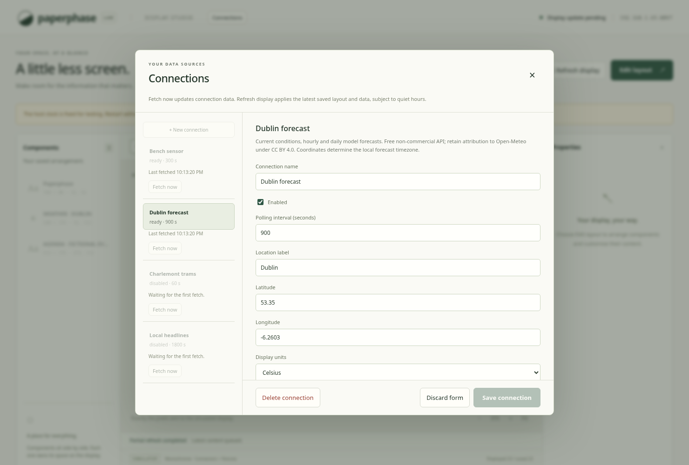

# Set up weather and headlines

Build the two portable plugins and the host from the repository root:

```sh
rustup target add wasm32-unknown-unknown
cargo build --locked --release --target wasm32-unknown-unknown \
  -p paperphase-weather-plugin -p paperphase-rss-plugin
cargo build --locked -p paperphase
cargo run --locked -p paperphase -- serve \
  --connector-bindings plugins/bindings.example.json
```

Open <http://127.0.0.1:8080>. Use `--listen 0.0.0.0:8080` for LAN access. Node is
only a frontend development/test dependency. Registration paths are relative to
the registration file; adjust them for a custom Cargo target directory. Initial
startup compiles the modules before announcing the service URL. The runtime is
still experimental and needs separate Pi resource measurements.

## Weather

1. Open **Connections → New connection**, then choose **Open-Meteo weather**.
2. Give the connection a useful name. Set the location label and latitude/
   longitude; the label does not perform a location search. Dublin coordinates
   are provided as defaults. Set Celsius/Fahrenheit, hourly/daily lengths, and
   the probability threshold for the rain summary.
3. Save. An enabled connection fetches automatically; Fetch now uses the same
   cooldown rules. It defaults to every 15 minutes, with a 10-minute minimum.
4. Close Connections, choose **Edit layout**, and select **Weather now**,
   **Hourly forecast**, or **Daily forecast** under **From your connections**.
   These create independent components already bound to this connection.
5. Arrange them, edit their contents if needed, then **Save to display**.



The free [Open-Meteo API](https://open-meteo.com/en/terms) is for non-commercial
use. Keep the template's Open-Meteo credit, CC BY 4.0 licence link, and notice of
rounding/conversion when customising or sharing a layout. Review the provider's
terms for your intended use and other applications sharing your network.

The rain summary describes an hourly forecast window; it is not an exact start
time. Hourly precipitation values apply to the hour ending at their `time`
timestamp. Templates show local times for the forecast location. Numeric
temperatures remain Celsius; `display-temperature` and other `display-*` fields
follow the selected units. The current observation can become stale before its
fetch age if the provider's observation is already old.

Use a separate connection for each location. Add your own components using
**Data field**, then select the connection's `current-weather`, `hourly`, or
`daily` dataset and the desired field/row. Row zero is the first upcoming hourly
endpoint or first forecast day. Forecast history is not retained across fetches.

Air quality will be a separate follow-up plugin; it is not fetched by this one.

## RSS and Atom

1. Create a connection using **RSS and Atom headlines**.
2. Enter the canonical public feed URL and label. UTF-8 RSS 2.0 and Atom are
   supported. Use the feed URL itself; the plugin does not discover feeds from
   website pages or follow redirects. URL credentials and fragments are rejected.
3. Select one to five headlines and an interval permitted by the publisher.
   The default is 30 minutes and the minimum is 15 minutes. RSS TTL may extend
   the next allowed fetch time beyond your configured interval.
4. Save, then add **Headlines** from that connection in the editor.

Check the publisher's access, polling and attribution requirements. Availability
of a feed is not permission to republish its content. This slice is for public
feeds: URLs appear in the login-free LAN settings UI, so do not use tokenised or
private feed URLs. No article pages, enclosures, or images are fetched.

The default card uses the aggregate headline field. Individual titles, links,
publication strings and source names remain available as dataset fields. Item
order follows the feed; automatic rotation is not implemented. Successful empty
feeds show the normal empty state. Errors retain old headlines with a stale-data
indicator. Feeds over 64 KiB, RSS 1.0/RDF, non-UTF-8 encodings, DTDs, and feeds
requiring authentication/redirects are unsupported in this version.

## Components show no data

Check the connection's fetch status before changing component bindings:

- **Plugin not loaded** means the settings/template exists but the service has
  no executable module for it. Restart with
  `--connector-bindings plugins/bindings.example.json` after building the guests.
  The Connections panel also shows **Enable fetching** with the launch command.
- A fixed-clock warning means the service was started with `--now`. Remove that
  option for real API use; otherwise future polling deadlines never arrive and
  live observations can appear stale against the old clock.
- **Disabled**, a fetch error, or a cooldown is a separate state. Enable the
  connection or inspect its error/next eligible time; Refresh display does not
  fetch data or bypass provider limits.

The demo weather settings descriptor is a form example and does not fetch
weather. Use **Open-Meteo weather** for the executable weather integration.
Loading modules and removing the fixed clock preserves saved layouts and
connection settings. Reload the page after restarting to pick up updated UI
assets.

## Refresh, backup, and verification

Fetch now retrieves data. Refresh display reevaluates saved content and remains
subject to display policy and quiet hours. A fetched update does not change the
layout revision or apply an unsaved draft. Templates need enough unoccupied
space; make room if adding one reports that it cannot fit. Component names can
be edited independently of their data and displayed content.

Back up the entire private `workspace.connections.json` alongside the layout,
preserving cached datasets and polling deadlines. Do not remove rate metadata
to force a request. Restart after changing the registration file. Changing a
feed URL/settings can retain an existing connection cooldown; separate
connections have separate feed TTLs and share origin-level cooldowns.

For complete development verification:

```sh
sh scripts/check.sh
pnpm --dir web build
cargo build --locked -p paperphase
pnpm --dir web test
```

The check script builds all three guests. For custom artifact directories the
browser tests accept `PAPERPHASE_TEST_BINARY`, `PAPERPHASE_TEST_PLUGIN`,
`PAPERPHASE_TEST_WEATHER_PLUGIN`, and `PAPERPHASE_TEST_RSS_PLUGIN`. The browser
harness uses local sources and fictional headlines; it makes no provider API
requests. See [the design](../design/weather-and-rss.md) for budgets and data
contracts, and [the changelog](../../changelog.md) for validation evidence.

Weather templates now use [plugin-owned icons](plugin-icons.md). Keep the weather
asset directory with the module; the example registration loads its manifest.
Existing layouts remain unchanged until edited or replaced with a new template.
